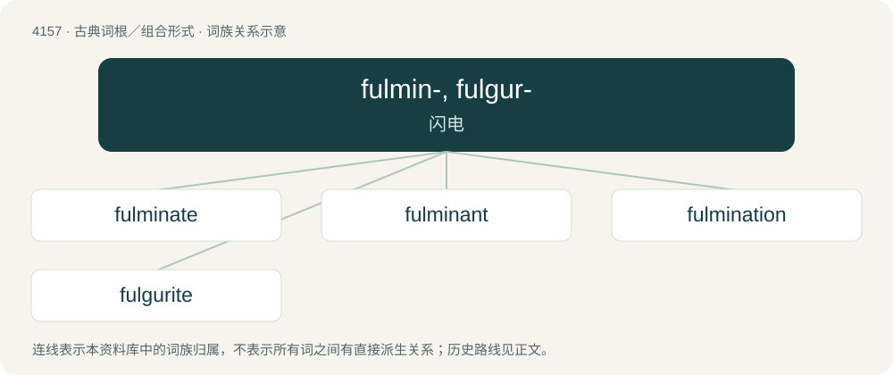

# 4168 · fulmin-, fulgur- — 闪电

[总目录](../00_总目录_按常用程度.md)

**类型**：古典词根／组合形式　｜　**来源语言**：拉丁语

## 核心含义与来源

- 核心含义：闪电
- 英文含义：flash
- 词形：fulmin-, fulgur-

**来源词形**：fulmen "lightning flash"

## 词族图

## 单词速览（常用到不常用）

| 单词 | 音标 | 释义 |
|---|---|---|
| [fulminate](#w-1) | 英 /ˈfʌlmɪneɪt/；美 /ˈfʌlmɪneɪt/ | vt. 使爆发, 以严词谴责；vi. 爆炸, 怒喝, 电闪；n. 雷酸盐, 烈性炸药 |
| [fulminant](#w-2) | /ˈfʌlminənt/ | a. 突然闪亮的, 轰响的, 爆炸的；\[医\] 暴发的 |
| [fulmination](#w-3) | 美 /fʌlmɪˈneɪʃən/ | n. 闪电, 爆鸣, 爆发；\[化\] 雷爆; 爆燃 |
| [fulgurite](#w-4) | /ˈfʌlgjurait/ | n. 闪电熔石, 闪电岩, 闪熔矿管 |

## 逐词详解

### 1. fulminate

**词性**：动词　｜　**音标**：英 /ˈfʌlmɪneɪt/；美 /ˈfʌlmɪneɪt/

**中文释义**：vt. 使爆发, 以严词谴责；vi. 爆炸, 怒喝, 电闪；n. 雷酸盐, 烈性炸药

**英文义项**：To make a verbal attack. / To issue as a denunciation.

**词源与演化**：

Inherited from Middle English fulminaten, borrowed from Latin fulminātus, perfect passive participle of fulminō (“to lighten, hurl or strike with lightning”) (see -ate (verb-forming suffix)), from fulmen (“lightning which strikes and sets on fire, thunderbolt”), from earlier \*fulgmen, \*fulgimen, from fulgeō, fulgō (“flash, lighten”). Doublet of fulmine. More at fulgent.

**例句**：

> In his books, he would often fulminate against the government and its policies.

### 2. fulminant

**词性**：形容词　｜　**音标**：/ˈfʌlminənt/

**中文释义**：a. 突然闪亮的, 轰响的, 爆炸的；\[医\] 暴发的

**英文义项**：That fulminates. / Appearing quickly and with destructive effects.

**构词拆分**：fulmine + -ant

**词源与演化**：

Borrowed from French fulminant, from Latin fulminō (“strike like lightning”). By surface analysis, fulmin(ate) + -ant or fulmine + -ant.

### 3. fulmination

**词性**：名词　｜　**音标**：美 /fʌlmɪˈneɪʃən/

**中文释义**：n. 闪电, 爆鸣, 爆发；\[化\] 雷爆; 爆燃

**英文义项**：The act of fulminating or exploding; detonation. / The act of thundering forth threats or censures, as with authority.

**构词拆分**：fulmine + -ation

**词源与演化**：

From Middle French fulmination, from Latin fulminātiō; equivalent to fulmine + -ation.

### 4. fulgurite

**词性**：名词　｜　**音标**：/ˈfʌlgjurait/

**中文释义**：n. 闪电熔石, 闪电岩, 闪熔矿管

**英文义项**：Glass formed by a lightning strike melting sand or other material.

**词源与演化**：

From Latin fulgur + -ite.
