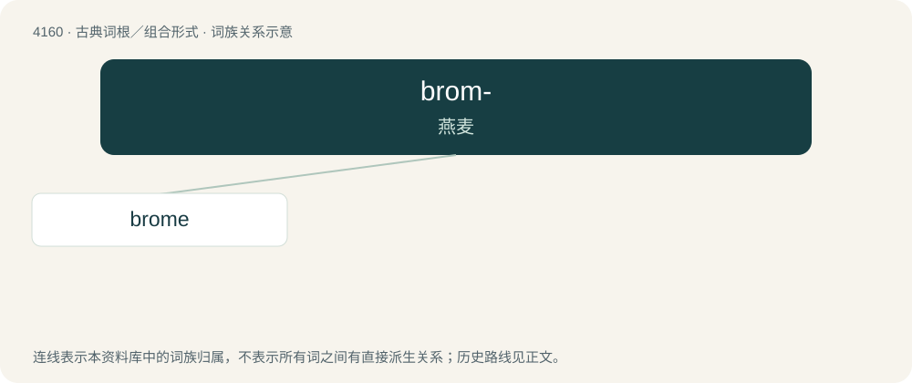

# 4171 · brom- — 燕麦

[总目录](../00_总目录_按常用程度.md)

**类型**：古典词根／组合形式　｜　**来源语言**：古希腊语

## 核心含义与来源

- 核心含义：燕麦
- 英文含义：oats
- 词形：brom-

**来源词形**：βρόμος, βρόμη (brómos, brómē) "oats"

## 词族图

## 单词速览（常用到不常用）

| 单词 | 音标 | 释义 |
|---|---|---|
| [brome](#w-1) | /bɹəʊm/ | 【英文】bromine |

## 逐词详解

### 1. brome

**词性**：名词　｜　**音标**：/bɹəʊm/

**英文义项**：bromine

**词源与演化**：

From French brome, coined from Ancient Greek βρῶμος (brômos, “stink”). Doublet of bromus.

## 其他候选词

- Bromus
- Bromus ramosus
