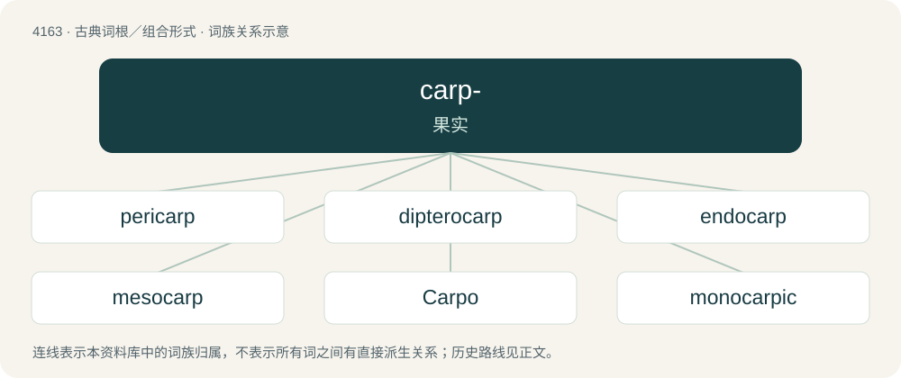

# 4174 · carp- — 果实

[总目录](../00_总目录_按常用程度.md)

**类型**：古典词根／组合形式　｜　**来源语言**：古希腊语

## 核心含义与来源

- 核心含义：果实
- 英文含义：fruit
- 词形：carp-

**来源词形**：καρπός (karpós)

## 词族图

## 单词速览（常用到不常用）

| 单词 | 音标 | 释义 |
|---|---|---|
| [pericarp](#w-1) | 英 /ˈpɛɹɪˌkɑːp/；美 /ˈpɛɹɪˌkɑɹp/ | n. 果皮；\[医\] 果皮 |
| [dipterocarp](#w-2) | /ˈdiptərəjkɑːp/ | n. 龙脑香科树(尤指羯布罗香) |
| [endocarp](#w-3) | 美 /ˈendōˌkärp/ | n. 内果皮；\[医\] 内果皮 |
| [mesocarp](#w-4) | /ˈmesəukɑːp/ | n. 中果皮；\[医\] 中果皮 |
| [Carpo](#w-5) |  | 【英文】One of the Horae, goddess/personification of Autumn and of harvest time. |
| [monocarpic](#w-6) | /,mɔnəˈkɑːpik/ | a. \[植\]结一次果的 |
| [Karpos](#w-7) |  | 【英文】A god/personification of fruit. |
| [acarpous](#w-8) | /eɪˈkɑɹ.pəs/ | a. \[植\]不结果的,无果实的 |
| [acrocarpous](#w-9) | /,ækrəˈkɑːpəs/ | a. \[植\]茎端结实的 |
| [angiocarpous](#w-10) | /,ændʒiəjˈkɑːpəs/ | a. 果实有壳的 |
| [carpogonium](#w-11) | /,kɑːpəˈ^əuniəm/ | n. 果胞；\[医\] 育胚器(子囊菌的雌性生殖器) |
| [carpology](#w-12) | /kɑːˈpɒlədʒi/ | n. 果实学 |
| [carpophagous](#w-13) | /kɑːˈpɔfə^əs/ | a. 食果的 |
| [carpophore](#w-14) | /ˈkɑːpəfɔː/ | n. \[植\]心皮柄, 果瓣柄 |
| [carpospore](#w-15) | /ˈkɑːpəspɔː/ | n. 果孢子；\[医\] 果孢子(植) |
| [cystocarp](#w-16) | /ˈsistəkɑːp/ | n. 囊果；\[医\] 孢子果; 子实体 |
| [epicarp](#w-17) | /ˈepikɑːp/ | n. \[植\]外果皮 |
| [exocarp](#w-18) | /ˈeksəukɑːp/ | n. \[植\]外果皮(指果皮的外层) |
| [mericarp](#w-19) |  | \[医\] 悬果片, 双悬果 |
| [polycarpic](#w-20) | /pɔliˈkɑːpik/ | 多次结果的 |
| [pseudocarp](#w-21) | /ˈsjuːdəkɑːp/ | n. 假果 |

## 逐词详解

### 1. pericarp

**词性**：名词　｜　**音标**：英 /ˈpɛɹɪˌkɑːp/；美 /ˈpɛɹɪˌkɑɹp/

**中文释义**：n. 果皮；\[医\] 果皮

**英文义项**：The outermost layer, or skin, of a ripe fruit or ovary. / The outer layer of anything.

**词源与演化**：

From French péricarpe, from New Latin pericarpium, from Ancient Greek περικάρπιον (perikárpion, “pod, husk, shell”), from περι- (peri-, “around”) + καρπός (karpós, “fruit”). By surface analysis, peri- + -carp.

### 2. dipterocarp

**词性**：名词　｜　**音标**：/ˈdiptərəjkɑːp/

**中文释义**：n. 龙脑香科树(尤指羯布罗香)

**英文义项**：any member of the family Dipterocarpaceae of tropical rainforest trees having two-winged fruits

**构词拆分**：di- + ptero- + -carp

**词源与演化**：

From di- + ptero- + -carp.

### 3. endocarp

**词性**：名词　｜　**音标**：美 /ˈendōˌkärp/

**中文释义**：n. 内果皮；\[医\] 内果皮

**英文义项**：The woody inner layer of the pericarp of some fruits that contains the seed: the tissue (uncountable) or the structure that it composes (countable).

**构词拆分**：endo- + -carp

**词源与演化**：

From endo- + -carp.

### 4. mesocarp

**词性**：名词　｜　**音标**：/ˈmesəukɑːp/

**中文释义**：n. 中果皮；\[医\] 中果皮

**英文义项**：The middle layer of the pericarp of a fruit. In many fruits such as drupes and tomatoes, the mesocarp is fleshy

**构词拆分**：meso- + -carp

**词源与演化**：

From meso- + -carp (from Ancient Greek μέσος (mésos, “middle”) + καρπός (karpós, “fruit”)).

### 5. Carpo

**词性**：专有名词

**英文义项**：One of the Horae, goddess/personification of Autumn and of harvest time.

**词源与演化**：

From Ancient Greek Καρπώ (Karpṓ) from καρπόω (karpóō, “bear fruit; reap or enjoy fruit”).

### 6. monocarpic

**词性**：形容词　｜　**音标**：/,mɔnəˈkɑːpik/

**中文释义**：a. \[植\]结一次果的

**英文义项**：(of a plant) That flowers and bears fruit only once before dying.

**构词拆分**：mono- + -carpic；monocarp + -ic

**词源与演化**：

From mono- + -carpic. Analyzable as monocarp + -ic.

### 7. Karpos

**词性**：专有名词

**英文义项**：A god/personification of fruit.

**词源与演化**：

From Ancient Greek καρπός (karpós, literally “Fruit”).

### 8. acarpous

**词性**：形容词　｜　**音标**：/eɪˈkɑɹ.pəs/

**中文释义**：a. \[植\]不结果的,无果实的

**英文义项**：Not producing fruit; unfruitful; sterile.

**词源与演化**：

Learned borrowing from Ancient Greek ἄκαρπος (ákarpos, “fruitless”), from privative ἀ- (a-) + καρπός (karpós, “fruit”).

### 9. acrocarpous

**词性**：形容词　｜　**音标**：/,ækrəˈkɑːpəs/

**中文释义**：a. \[植\]茎端结实的

**英文义项**：Developing the archegonium on the summit of the primary stem; fruiting at tips, in the manner of mosses.

**构词拆分**：acro- + -carpous

**词源与演化**：

From acro- + -carpous.

### 10. angiocarpous

**词性**：形容词　｜　**音标**：/,ændʒiəjˈkɑːpəs/

**中文释义**：a. 果实有壳的

**英文义项**：Describing a plant whose fruit is in an envelope and not part of a calyx.

**构词拆分**：angio- + -carpous

**词源与演化**：

From angio- + -carpous.

### 11. carpogonium

**词性**：名词　｜　**音标**：/,kɑːpəˈ^əuniəm/

**中文释义**：n. 果胞；\[医\] 育胚器(子囊菌的雌性生殖器)

**英文义项**：The female organ in the red algae (Rhodophyta), having an elongated process which is the receptive organ for the male gametes

**构词拆分**：carpo- + -gonium

**词源与演化**：

From carpo- + -gonium.

### 12. carpology

**词性**：名词　｜　**音标**：/kɑːˈpɒlədʒi/

**中文释义**：n. 果实学

**英文义项**：the study of the structure of seeds and fruit

**构词拆分**：carpo- + -logy

**词源与演化**：

From carpo- + -logy.

### 13. carpophagous

**词性**：形容词　｜　**音标**：/kɑːˈpɔfə^əs/

**中文释义**：a. 食果的

**英文义项**：fruit-eating.

**构词拆分**：carpo- + -phagous

**词源与演化**：

From carpo- + -phagous, from Ancient Greek.

**用法示例／搭配（非完整句）**：

> carpophagous insect

该用例对应义项：fruit-eating.

### 14. carpophore

**词性**：名词　｜　**音标**：/ˈkɑːpəfɔː/

**中文释义**：n. \[植\]心皮柄, 果瓣柄

**英文义项**：A thin stalk that raises the pistil above the stamens in some plants. / The stem of the fruiting body in higher fungi.

**构词拆分**：carpo- + -phore

**词源与演化**：

From carpo- + -phore.

### 15. carpospore

**词性**：名词　｜　**音标**：/ˈkɑːpəspɔː/

**中文释义**：n. 果孢子；\[医\] 果孢子(植)

**英文义项**：A kind of spore formed in the conceptacles of red algae.

**构词拆分**：carpo- + spore

**词源与演化**：

From carpo- + spore.

### 16. cystocarp

**词性**：名词　｜　**音标**：/ˈsistəkɑːp/

**中文释义**：n. 囊果；\[医\] 孢子果; 子实体

**英文义项**：A minute vesicle in some seaweeds, containing the reproductive carpospores.

**构词拆分**：cysto- + -carp

**词源与演化**：

From cysto- + -carp, from Ancient Greek κύστις (kústis, “bladder”) + καρπός (karpós, “fruit”).

### 17. epicarp

**词性**：名词　｜　**音标**：/ˈepikɑːp/

**中文释义**：n. \[植\]外果皮

**英文义项**：Exocarp.

**构词拆分**：epi- + -carp

**词源与演化**：

epi- + Ancient Greek καρπός (karpós, “fruit”); epi- + -carp.

### 18. exocarp

**词性**：名词　｜　**音标**：/ˈeksəukɑːp/

**中文释义**：n. \[植\]外果皮(指果皮的外层)

**英文义项**：The outermost layer of the pericarp of fruits; the skin or epicarp.

**构词拆分**：exo- + -carp

**词源与演化**：

From exo- + Ancient Greek καρπός (karpós, “fruit”); exo- + -carp.

### 19. mericarp

**词性**：名词

**中文释义**：\[医\] 悬果片, 双悬果

**英文义项**：An individual carpel of a schizocarp, having a single seed

**构词拆分**：mero- + -carp

**词源与演化**：

From mero- + -carp.

### 20. polycarpic

**词性**：形容词　｜　**音标**：/pɔliˈkɑːpik/

**中文释义**：多次结果的

**英文义项**：Bearing fruit repeatedly, or year after year. / Having several carpels in one flower.

**构词拆分**：poly- + -carpic

**词源与演化**：

From poly- + -carpic.

**用法示例／搭配（非完整句）**：

> polycarpic growth

该用例对应义项：Bearing fruit repeatedly, or year after year.

### 21. pseudocarp

**词性**：名词　｜　**音标**：/ˈsjuːdəkɑːp/

**中文释义**：n. 假果

**英文义项**：An accessory fruit.

**构词拆分**：pseudo- + -carp

**词源与演化**：

From pseudo- + -carp.

## 其他候选词

- amphicarpous
- anisocarpic
- procarp
