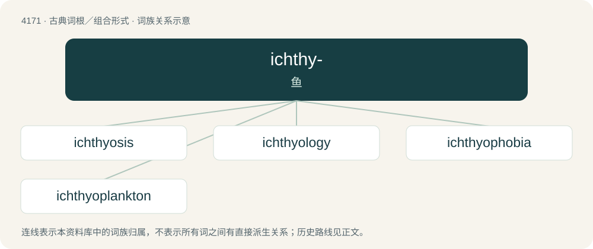

# 4178 · ichthy- — 鱼

[总目录](../00_总目录_按常用程度.md)

**类型**：古典词根／组合形式　｜　**来源语言**：古希腊语

## 核心含义与来源

- 核心含义：鱼
- 英文含义：fish
- 词形：ichthy-

**来源词形**：ἰχθύς, ἰχθύος (ikhthús, ikhthúos)

## 词族图

## 单词速览（常用到不常用）

| 单词 | 音标 | 释义 |
|---|---|---|
| [ichthyosis](#w-1) | 英 /ˌɪk.θiːˈəʊ̯.sɪs/；美 /ˌɪk.θiˈoʊ̯.sɪs/ | n. \[医\]鱼鳞癣 |
| [ichthyology](#w-2) | /ˌɪkθiˈɒləd͡ʒi/ | n. 鱼类学；\[医\] 鱼类学 |
| [ichthyophobia](#w-3) | /,ikθiəˈfəubiə/ | \[心理\]鱼恐怖 |
| [ichthyoplankton](#w-4) |  | 【英文】zooplankton derived from fish, such as fish eggs, fry and larvae |

## 逐词详解

### 1. ichthyosis

**词性**：名词　｜　**音标**：英 /ˌɪk.θiːˈəʊ̯.sɪs/；美 /ˌɪk.θiˈoʊ̯.sɪs/

**中文释义**：n. \[医\]鱼鳞癣

**英文义项**：Any of a group of genetic skin disorders characterized by dry, thickened, scaly skin.

### 2. ichthyology

**词性**：名词　｜　**音标**：/ˌɪkθiˈɒləd͡ʒi/

**中文释义**：n. 鱼类学；\[医\] 鱼类学

**英文义项**：A branch of zoology that studies fish.

**构词拆分**：ichthyo- + -logy

**词源与演化**：

From ichthyo- + -logy.

### 3. ichthyophobia

**词性**：名词　｜　**音标**：/,ikθiəˈfəubiə/

**中文释义**：\[心理\]鱼恐怖

**英文义项**：The fear of fish.

**构词拆分**：ichthyo- + -phobia

**词源与演化**：

From ichthyo- + -phobia.

### 4. ichthyoplankton

**词性**：名词

**英文义项**：zooplankton derived from fish, such as fish eggs, fry and larvae

**构词拆分**：ichthyo- + plankton

**词源与演化**：

From ichthyo- + plankton.

## 其他候选词

- Ichthyophaga
