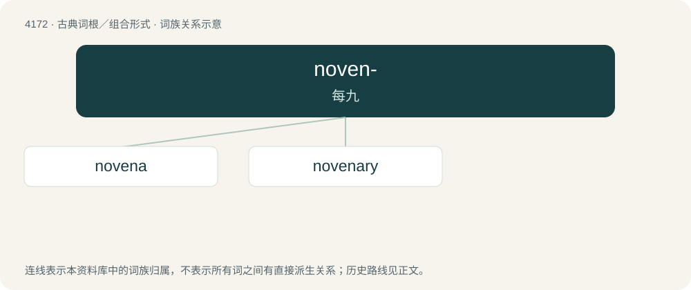

# 4179 · noven- — 每九

[总目录](../00_总目录_按常用程度.md)

**类型**：古典词根／组合形式　｜　**来源语言**：拉丁语

## 核心含义与来源

- 核心含义：每九
- 英文含义：nine each
- 词形：noven-

**来源词形**：noveni

## 词族图

## 单词速览（常用到不常用）

| 单词 | 音标 | 释义 |
|---|---|---|
| [novena](#w-1) | /nəuˈviːnə/ | n. 连续九天的祷告式 |
| [novenary](#w-2) | /nəuˈviːnəri/ | 九进制的 |

## 逐词详解

### 1. novena

**词性**：名词　｜　**音标**：/nəuˈviːnə/

**中文释义**：n. 连续九天的祷告式

**英文义项**：A recitation of prayers and devotions for nine consecutive days, especially one to a saint to ask for their intercession.

**词源与演化**：

From Ecclesiastical Latin novēna, from Latin novēnus (“nine \[each\]”).

### 2. novenary

**词性**：名词　｜　**音标**：/nəuˈviːnəri/

**中文释义**：九进制的

**英文义项**：A group of nine.

**词源与演化**：

From Latin novenarius, from novem (“nine”).
