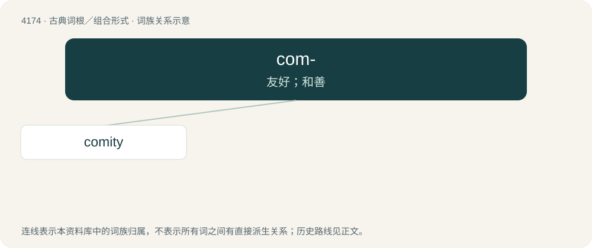

# 4181 · com- — 友好；和善

[总目录](../00_总目录_按常用程度.md)

**类型**：古典词根／组合形式　｜　**来源语言**：拉丁语

## 核心含义与来源

- 核心含义：友好；和善
- 英文含义：friendly, kind
- 词形：com-

**来源词形**：cōmis "courteous, kind"

## 词族图

## 单词速览（常用到不常用）

| 单词 | 音标 | 释义 |
|---|---|---|
| [comity](#w-1) | /ˈkɒmɪti/ | n. 礼貌, 礼让；\[法\] 礼让, 友谊 |

## 逐词详解

### 1. comity

**词性**：名词　｜　**音标**：/ˈkɒmɪti/

**中文释义**：n. 礼貌, 礼让；\[法\] 礼让, 友谊

**英文义项**：Courtesy and considerate behaviour towards others; social harmony. / Friendly understanding and mutual recognition between two entities, especially nations.

**词源与演化**：

From Late Middle English comite (“association”), from Latin cōmitās.
