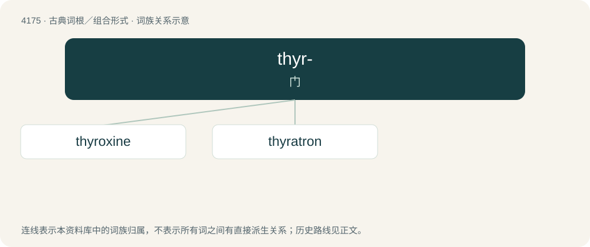

# 4183 · thyr- — 门

[总目录](../00_总目录_按常用程度.md)

**类型**：古典词根／组合形式　｜　**来源语言**：古希腊语

## 核心含义与来源

- 核心含义：门
- 英文含义：door
- 词形：thyr-

**来源词形**：θύρα (thúra)

## 词族图

## 单词速览（常用到不常用）

| 单词 | 音标 | 释义 |
|---|---|---|
| [thyroxine](#w-1) | 英 /θaɪˈrɒk.siːn/；美 /θaɪˈrɒk.sin/ | n. 甲状腺素；\[化\] 甲状腺素 |
| [thyratron](#w-2) | 英 /ˈθaɪ.ɹəˌtɹɒn/；美 /ˈθaɪ.ɹəˌtɹɑn/ | n. 闸流管；\[医\] 闸流管 |

## 逐词详解

### 1. thyroxine

**词性**：名词　｜　**音标**：英 /θaɪˈrɒk.siːn/；美 /θaɪˈrɒk.sin/

**中文释义**：n. 甲状腺素；\[化\] 甲状腺素

**英文义项**：A thyroid hormone, with the chemical formula C₁₅H₁₁I₄NO₄, that regulates cell metabolism and growth.

**构词拆分**：thyr- + ox- + -ine

**词源与演化**：

From thyr- (“thyroid”) + ox- (“oxygen”) + -ine.

**例句**：

> Thyroxine is 65% iodine.

该用例对应义项：hormone produced by the thyroid glands to regulate metabolism by controlling the rate of oxidation in cells

### 2. thyratron

**词性**：名词　｜　**音标**：英 /ˈθaɪ.ɹəˌtɹɒn/；美 /ˈθaɪ.ɹəˌtɹɑn/

**中文释义**：n. 闸流管；\[医\] 闸流管

**英文义项**：Any of several types of thermoelectric valve once used as a high-speed switch

**构词拆分**：Ancient Greek θύρα (thúra, “door”) + -tron

**词源与演化**：

From Ancient Greek θύρα (thúra, “door”) + -tron. Originally a trademark, registered 17 June 1930 by the General Electric Company (United States Patent Office, Registration No. 271-660).
