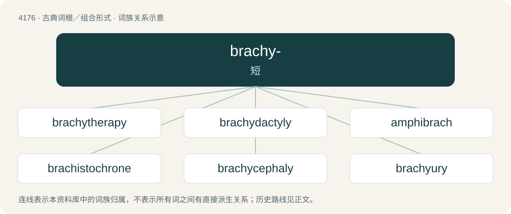

# 4184 · brachy- — 短

[总目录](../00_总目录_按常用程度.md)

**类型**：古典词根／组合形式　｜　**来源语言**：古希腊语

## 核心含义与来源

- 核心含义：短
- 英文含义：short
- 词形：brachy-

**来源词形**：βραχύς (brakhús)

## 词族图

## 单词速览（常用到不常用）

| 单词 | 音标 | 释义 |
|---|---|---|
| [brachytherapy](#w-1) | /ˌbɹækiˈθɛrəpi/ | n. \[特医\] 短距离放射治疗；短程疗法 |
| [brachydactyly](#w-2) | /,brækiˈdæktili/ | n. \[医\]短指(或短趾)畸形 |
| [amphibrach](#w-3) | 英 /ˈam.fɪ.bɹak/ | n. \[语\]短长短格 |
| [brachistochrone](#w-4) | 英 /bɹəˈkɪstəkɹəʊn/；美 /bɹæˈkɪstəkɹoʊn/ | n. \[数\]最速降线,捷线 |
| [brachycephaly](#w-5) |  | \[医\] 短头\[畸形\] |
| [brachyury](#w-6) |  | 【英文】The presence of an abnormally short tail in some animals as a result of a genetic mutation. |
| [tribrach](#w-7) | 英 /ˈtɹaɪbɹæk/ | n. 三短节音步 |

## 逐词详解

### 1. brachytherapy

**词性**：名词　｜　**音标**：/ˌbɹækiˈθɛrəpi/

**中文释义**：n. \[特医\] 短距离放射治疗；短程疗法

**英文义项**：Radiotherapy using radioactive sources positioned within (or close to) the treatment volume, typically with radiopharmaceuticals as opposed to external-beam sources.

**构词拆分**：brachy- + therapy

**词源与演化**：

From Ancient Greek βραχύς (brakhús, “short, not far off”) + θεραπεία (therapeía, “attendance, treatment, healing, service”); brachy- + therapy.

### 2. brachydactyly

**词性**：名词　｜　**音标**：/,brækiˈdæktili/

**中文释义**：n. \[医\]短指(或短趾)畸形

**英文义项**：Abnormal shortness of the fingers or toes

**构词拆分**：From brachy- + dactyly.

**词源与演化**：

From brachy- + dactyly.

### 3. amphibrach

**词性**：名词　｜　**音标**：英 /ˈam.fɪ.bɹak/

**中文释义**：n. \[语\]短长短格

**英文义项**：A metrical foot in ancient Greek or Latin consisting of two short syllables surrounding one long one (e.g. amāta). / A metrical foot in modern prosody, consisting of three syllables, the middle one of which is stressed (e.g. Jamaica).

**词源与演化**：

From Latin amphibrachys, from Ancient Greek ἀμφίβραχυς (amphíbrakhus, “short at both ends”), from ἀμφί (amphí) + βραχύς (brakhús, “short”).

### 4. brachistochrone

**词性**：名词　｜　**音标**：英 /bɹəˈkɪstəkɹəʊn/；美 /bɹæˈkɪstəkɹoʊn/

**中文释义**：n. \[数\]最速降线,捷线

**英文义项**：A cycloid; the curve of fastest descent between two points.

**词源与演化**：

From Ancient Greek βράχιστος (brákhistos, “shortest”) + χρόνος (khrónos, “time”). The term was coined by Johann Bernoulli.

### 5. brachycephaly

**词性**：名词

**中文释义**：\[医\] 短头\[畸形\]

**英文义项**：A congenital condition wherein the skull is flattened front-to-back, so that the head is short and broad.

**构词拆分**：brachy- + -cephaly

**词源与演化**：

From brachy- + -cephaly.

### 6. brachyury

**词性**：名词

**英文义项**：The presence of an abnormally short tail in some animals as a result of a genetic mutation.

### 7. tribrach

**词性**：名词　｜　**音标**：英 /ˈtɹaɪbɹæk/

**中文释义**：n. 三短节音步

**英文义项**：A metrical foot consisting of three short syllables.

**词源与演化**：

From the Latin tribrachys, from the Ancient Greek τρῐ́βρᾰχῠς (trĭ́brăkhŭs), from τρῐ- (trĭ-, “tri-”) + βρᾰχῠ́ς (brăkhŭ́s, “short”). Compare the French tribraque.

## 其他候选词

- dibrach
