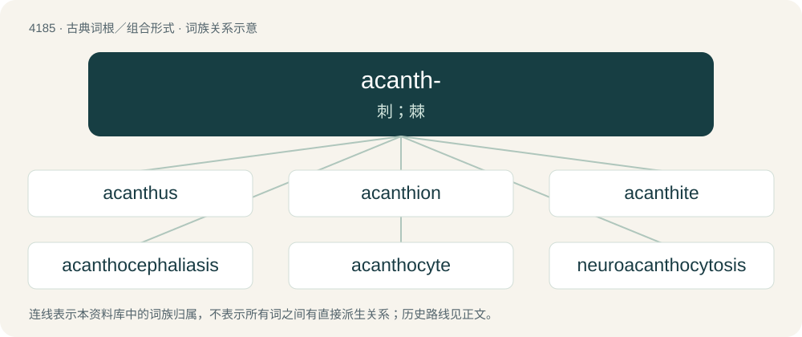

# 4192 · acanth- — 刺；棘

[总目录](../00_总目录_按常用程度.md)

**类型**：古典词根／组合形式　｜　**来源语言**：古希腊语

## 核心含义与来源

- 核心含义：刺；棘
- 英文含义：thorn
- 词形：acanth-

**来源词形**：ἀκή, ἄκανθα (ákantha)

## 词族图

## 单词速览（常用到不常用）

| 单词 | 音标 | 释义 |
|---|---|---|
| [acanthus](#w-1) | 英 /əˈkæn.θəs/；美 /əˈkæn.θəs/ | n. 叶形装饰 |
| [acanthion](#w-2) | 美 /əˈkæn.θi.n̩/ | \[医\] 鼻前棘点 |
| [acanthite](#w-3) | 英 /əˈkæn.θaɪt/；美 /əˈkæn.θaɪt/ | \[机\] 螺状硫银矿 |
| [acanthocephaliasis](#w-4) | 美 /æˌkæn.θoʊ.sɜf.əˈlaɪ.ə.sɪs/ | \[医\] 棘头虫病 |
| [acanthocyte](#w-5) | 美 /əˈkæn.θoʊˌsaɪt/ | \[医\] 棘红细胞 |
| [neuroacanthocytosis](#w-6) |  | 【英文】A rare inherited neurological disorder in which the brain progressively degenerates, causing movement and behavioral problems, along with abnormal spiky red blood cells called acanthocytes. |

## 逐词详解

### 1. acanthus

**词性**：名词　｜　**音标**：英 /əˈkæn.θəs/；美 /əˈkæn.θəs/

**中文释义**：n. 叶形装饰

**英文义项**：A member of the genus Acanthus of herbaceous prickly plants with toothed leaves, (family Acanthaceae, order Lamiales (formerly Scrophulariales)) found in the south of Europe, Asia Minor, and India. / An ornament resembling the foliage or leaves of Acanthus spinosus, used in the capitals of the Corinthian and composite orders.

**词源与演化**：

From Latin acanthus, from Ancient Greek ἄκανθος (ákanthos, “thorn”), from ἀκή (akḗ, “point”) + ἄνθος (ánthos, “flower”).

### 2. acanthion

**词性**：名词　｜　**音标**：美 /əˈkæn.θi.n̩/

**中文释义**：\[医\] 鼻前棘点

**英文义项**：A point lying near the base of the nose; specifically, the point at the base of the anterior nasal spine that lies on the mesial line; tip of the anterior nasal spine.

**词源与演化**：

From New Latin acanthion, from Ancient Greek ἄκανθα (ákantha, “thorn”) + -ion.

### 3. acanthite

**词性**：名词　｜　**音标**：英 /əˈkæn.θaɪt/；美 /əˈkæn.θaɪt/

**中文释义**：\[机\] 螺状硫银矿

**英文义项**：A mineral form of silver sulfide, Ag₂S, that is a major ore of silver, that forms slender prisms.

**词源与演化**：

Named in 1855, from Ancient Greek ἄκανθα (ákantha, “thorn”) + -ite, because of the crystal shapes.

### 4. acanthocephaliasis

**词性**：名词　｜　**音标**：美 /æˌkæn.θoʊ.sɜf.əˈlaɪ.ə.sɪs/

**中文释义**：\[医\] 棘头虫病

**英文义项**：A disease caused by infection by Acanthocephala worms.

**词源与演化**：

From taxonomic name Acanthocephala + -iasis (“disease produced by”).

### 5. acanthocyte

**词性**：名词　｜　**音标**：美 /əˈkæn.θoʊˌsaɪt/

**中文释义**：\[医\] 棘红细胞

**英文义项**：A pathological, irregularly spiked red blood cell without central pallor.

**词源与演化**：

From Ancient Greek ἄκανθα (ákantha, “thorn”) + κύτος (kútos, “cell”)

### 6. neuroacanthocytosis

**词性**：名词

**英文义项**：A rare inherited neurological disorder in which the brain progressively degenerates, causing movement and behavioral problems, along with abnormal spiky red blood cells called acanthocytes.

**构词拆分**：neuro- + acantho- + cyto- + -sis

**词源与演化**：

From neuro- + acantho- + cyto- + -sis.

## 其他候选词

- Acanthaster
- Acanthocephala
- Acanthomintha
- Acanthosaura
- Metriacanthosaurus
