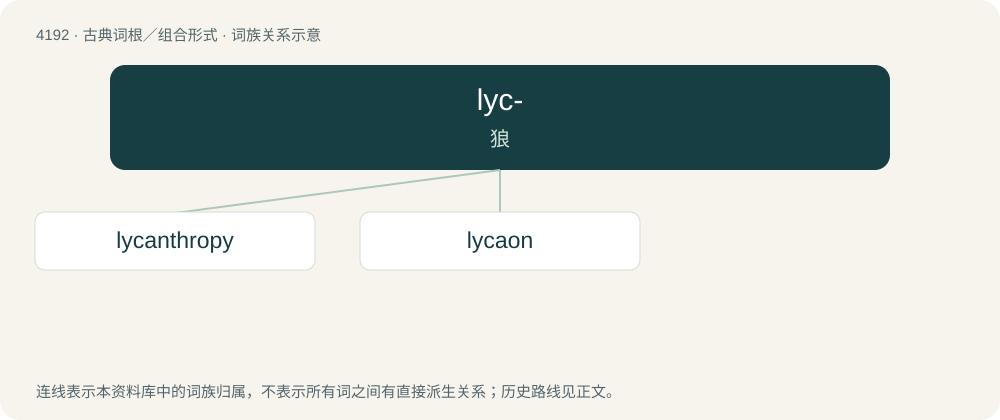

# 4200 · lyc- — 狼

[总目录](../00_总目录_按常用程度.md)

**类型**：古典词根／组合形式　｜　**来源语言**：古希腊语

## 核心含义与来源

- 核心含义：狼
- 英文含义：wolf
- 词形：lyc-

**来源词形**：λύκος (lýkos)

## 词族图

## 单词速览（常用到不常用）

| 单词 | 音标 | 释义 |
|---|---|---|
| [lycanthropy](#w-1) | 英 /laɪ̯ˈkæn.θɹə.piː/；美 /laɪ̯ˈkæn.θɹə.pi/ | n. (神话中)会变成狼的人, 变狼狂；\[医\] 变狼忘想 |
| [lycaon](#w-2) |  | 【英文】An eastern wolf or Algonquin wolf of Canis lycaon or subspecies Canis lupus lycaon. |

## 逐词详解

### 1. lycanthropy

**词性**：名词　｜　**音标**：英 /laɪ̯ˈkæn.θɹə.piː/；美 /laɪ̯ˈkæn.θɹə.pi/

**中文释义**：n. (神话中)会变成狼的人, 变狼狂；\[医\] 变狼忘想

**英文义项**：The state of being a lycanthrope (or werewolf), a person who can shapeshift between the form of a human being and a wolf, often said to happen involuntarily during a full moon; werewolfdom. / The state of being a person who can shapeshift between the form of a human being and an animal, whether or not it is a wolf.

**词源与演化**：

Borrowed from Ancient Greek λῠκᾰνθρωπῐ́ᾱ (lŭkănthrōpĭ́ā), from λῠκᾰ́νθρωπος (lŭkắnthrōpos, “wolfman”). By surface analysis, lycanthrope + -y (abstract noun suffix).

### 2. lycaon

**词性**：专有名词

**英文义项**：An eastern wolf or Algonquin wolf of Canis lycaon or subspecies Canis lupus lycaon.

**词源与演化**：

From New Latin, from Ancient Greek Λυκάων (Lukáōn, “Lycaon”) the mythological king of Arcadia who was transformed into a wolf by Zeus, λυκάων (lukáōn, “wolves”), from λύκος (lúkos, “wolf”).

## 其他候选词

- lycopersicon
