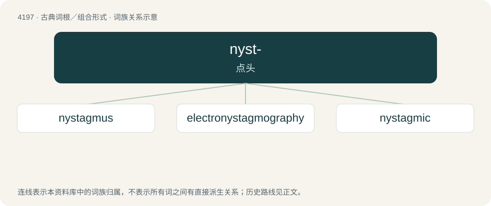

# 4205 · nyst- — 点头

[总目录](../00_总目录_按常用程度.md)

**类型**：古典词根／组合形式　｜　**来源语言**：古希腊语

## 核心含义与来源

- 核心含义：点头
- 英文含义：nod
- 词形：nyst-

**来源词形**：νυστάζειν (nustázein), (nustagmós)

## 词族图

## 单词速览（常用到不常用）

| 单词 | 音标 | 释义 |
|---|---|---|
| [nystagmus](#w-1) | /nɪˈstæɡ.məs/ | n. 眼球震颤；\[医\] 眼球震颤 |
| [electronystagmography](#w-2) | /iˈlektrəj,nistæ^ˈmɔ^rəfi/ | \[医\] 眼震电流描记法 |
| [nystagmic](#w-3) | /niˈstægmik/ | a. 眼球震颤的 |

## 逐词详解

### 1. nystagmus

**词性**：名词　｜　**音标**：/nɪˈstæɡ.məs/

**中文释义**：n. 眼球震颤；\[医\] 眼球震颤

**英文义项**：Rapid and excessive involuntary eye movement, usually lateral.

**词源与演化**：

First attested in 1798. From New Latin nystagmus, from Ancient Greek νυσταγμός (nustagmós, “nodding, drowsiness”), from νυστάζω (nustázō, “nod, be sleepy”).

### 2. electronystagmography

**词性**：名词　｜　**音标**：/iˈlektrəj,nistæ^ˈmɔ^rəfi/

**中文释义**：\[医\] 眼震电流描记法

**英文义项**：A diagnostic test to record involuntary movements of the eye caused by a condition known as nystagmus. It can also be used to diagnose the cause of vertigo, dizziness or balance dysfunction by testing the vestibular system.

**构词拆分**：electro- + nystagmography

**词源与演化**：

From electro- + nystagmography.

### 3. nystagmic

**词性**：形容词　｜　**音标**：/niˈstægmik/

**中文释义**：a. 眼球震颤的

**英文义项**：Exhibiting or pertaining to nystagmus (involuntary eye movement).

**构词拆分**：nystagmus + -ic

**词源与演化**：

From nystagmus + -ic.
