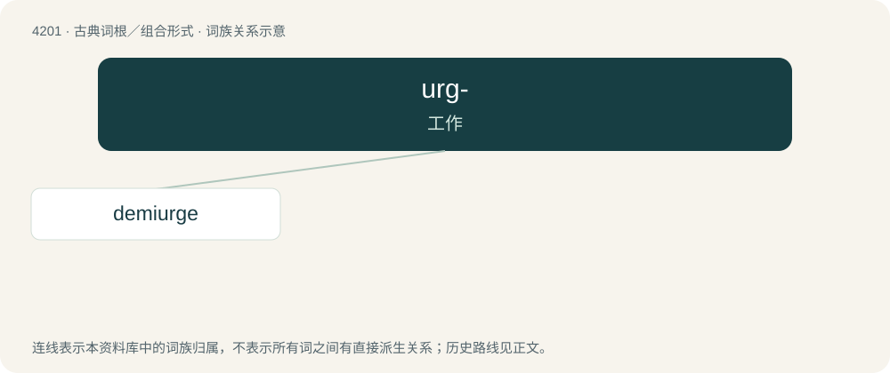

# 4209 · urg- — 工作

[总目录](../00_总目录_按常用程度.md)

**类型**：古典词根／组合形式　｜　**来源语言**：古希腊语

## 核心含义与来源

- 核心含义：工作
- 英文含义：work
- 词形：urg-

## 词族图

## 单词速览（常用到不常用）

| 单词 | 音标 | 释义 |
|---|---|---|
| [demiurge](#w-1) | 英 /ˈdɛm.i.ɜːd͡ʒ/；美 /ˈdɛm.i.ɚd͡ʒ/ | n. 造物主 |

## 逐词详解

### 1. demiurge

**词性**：名词　｜　**音标**：英 /ˈdɛm.i.ɜːd͡ʒ/；美 /ˈdɛm.i.ɚd͡ʒ/

**中文释义**：n. 造物主

**英文义项**：The (usually benevolent) being that created the universe out of primal matter. / A (usually jealous or outright malevolent) being who is inferior to the supreme being, and sometimes seen as the creator of evil.

**词源与演化**：

From Ancient Greek δημιουργός (dēmiourgós, “one who works for the people; a skilled workman, a handicraftsman”) (whence Latin dēmiūrgus, French démiurge), from δήμιος (dḗmios, “belonging to the people, public”) (from δῆμος (dêmos, “the people”), from Proto-Indo-European \*deh₂mos (“people”), from \*deh₂- (“to divide”) + Ancient Greek -ιος (-ios), from Proto-Indo-European \*-yós (suffix creating an adjective from a noun)) + Ancient Greek -ουργός (-ourgós, “worker”) (from ἔργον (érgon, “labour; task; work”), from Proto-Indo-European \*wérǵom (“work”)). No relation with English demi- (as in demigod).

**例句**：

> A demiurge or craftsman god takes pre-existing matter and fashions it in light of the eternal Forms.

该用例对应义项：The (usually benevolent) being that created the universe out of primal matter.
