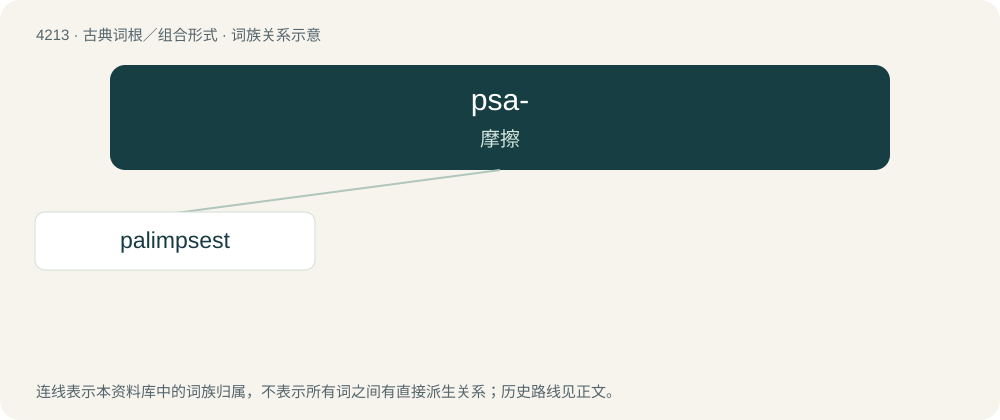

# 4221 · psa- — 摩擦

[总目录](../00_总目录_按常用程度.md)

**类型**：古典词根／组合形式　｜　**来源语言**：古希腊语

## 核心含义与来源

- 核心含义：摩擦
- 英文含义：rub
- 词形：psa-

**来源词形**：ψᾶν (psân), ψαφαρός, ψήχειν, (psēstós)

## 词族图

## 单词速览（常用到不常用）

| 单词 | 音标 | 释义 |
|---|---|---|
| [palimpsest](#w-1) | 英 /ˈpælɪmpsɛst/ | n. 重写本, 覆画 |

## 逐词详解

### 1. palimpsest

**词性**：名词　｜　**音标**：英 /ˈpælɪmpsɛst/

**中文释义**：n. 重写本, 覆画

**英文义项**：A manuscript or document that has been erased or scraped clean, for reuse of the paper, parchment, vellum, or other medium on which it was written. / Monumental brasses that have been reused by engraving of the blank back side.

**词源与演化**：

From Latin palimpsēstus, from Ancient Greek παλίμψηστος (palímpsēstos, “scraped again”).

**例句**：

> The eraser you lent me doesn't work very well, which combined with my perfectionism led to my sketch looking like a palimpsest.
