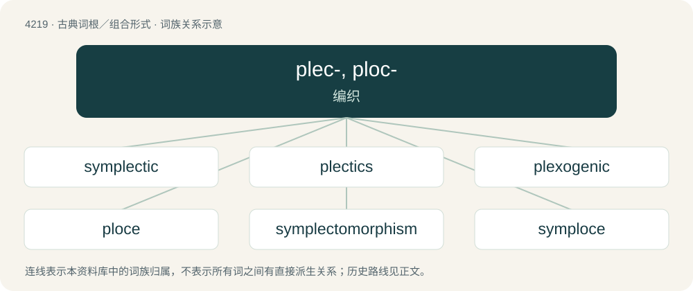

# 4226 · plec-, ploc- — 编织

[总目录](../00_总目录_按常用程度.md)

**类型**：古典词根／组合形式　｜　**来源语言**：古希腊语

## 核心含义与来源

- 核心含义：编织
- 英文含义：plait, interweave
- 词形：plec-, ploc-

**来源词形**：πλέκειν (plékein), πλεκτός (plektós), πλεκτικός (plektikós), πλέξις (pléxis), πλέγμα (plégma), πλοκή (plokḗ), πλόκος

## 词族图

## 单词速览（常用到不常用）

| 单词 | 音标 | 释义 |
|---|---|---|
| [symplectic](#w-1) | /sɪmˈplɛktɪk/ | a. 偶对的; 耦对; 续骨 |
| [plectics](#w-2) |  | 【英文】the study of complexity and its underlying simplicity |
| [plexogenic](#w-3) |  | 【英文】Giving rise to weblike or plexiform structures. |
| [ploce](#w-4) | /ˈplɒsi/ | n. 普洛切（克罗地亚港口） |
| [symplectomorphism](#w-5) |  | 【英文】An isomorphism of a symplectic manifold; a diffeomorphism which preserves symplectic structure. |
| [symploce](#w-6) | 英 /ˈsɪmploʊsi/ | n. 【修辞学】首语重复和尾词重复的并用 |

## 逐词详解

### 1. symplectic

**词性**：形容词　｜　**音标**：/sɪmˈplɛktɪk/

**中文释义**：a. 偶对的; 耦对; 续骨

**英文义项**：Placed in or among, as if woven together. / Whose characteristic abelian subgroups are cyclic.

**词源与演化**：

A calque of complex, coined by Hermann Weyl in his 1939 book The Classical Groups: Their Invariants and Representations. From Ancient Greek συμπλεκτικός (sumplektikós), from συμ (sum) (variant of σύν (sún)), + πλεκτικός (plektikós) (from πλέκω (plékō)); modelled on complex (from Latin complexus (“braided together”), from com- (“together”) + plectere (“to weave, braid”)). The symplectic group has previously been called the line complex group.

### 2. plectics

**词性**：名词

**英文义项**：the study of complexity and its underlying simplicity

**词源与演化**：

From Ancient Greek πλεκτός (plektós, “braided”) + -ics, but invented by Murray Gell-Mann.

### 3. plexogenic

**词性**：形容词

**英文义项**：Giving rise to weblike or plexiform structures.

**构词拆分**：plexo- + -genic

**词源与演化**：

From plexo- + -genic.

### 4. ploce

**词性**：名词　｜　**音标**：/ˈplɒsi/

**中文释义**：n. 普洛切（克罗地亚港口）

**英文义项**：A figure of speech in which a word is repeated so as not only to signify the individual thing denoted by it, but also its peculiar attribute or quality.

**词源与演化**：

From Latin plŏcē, from Ancient Greek πλοκή (plokḗ, “complication”).

### 5. symplectomorphism

**词性**：名词

**英文义项**：An isomorphism of a symplectic manifold; a diffeomorphism which preserves symplectic structure.

**词源与演化**：

Blend of symplectic + isomorphism.

### 6. symploce

**词性**：名词　｜　**音标**：英 /ˈsɪmploʊsi/

**中文释义**：n. 【修辞学】首语重复和尾词重复的并用

**英文义项**：The repetition of one word or phrase at the beginning and another word or phrase at the end of successive phrases or clauses.

**词源与演化**：

From Ancient Greek συμπλοκή (sumplokḗ, “interweaving”).
