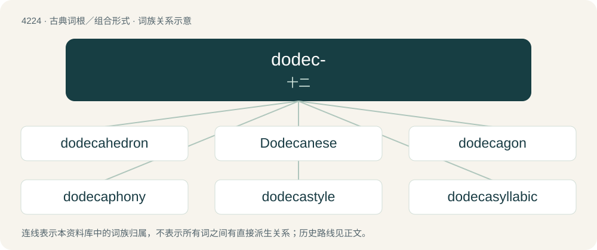

# 4231 · dodec- — 十二

[总目录](../00_总目录_按常用程度.md)

**类型**：古典词根／组合形式　｜　**来源语言**：古希腊语

## 核心含义与来源

- 核心含义：十二
- 英文含义：twelve
- 词形：dodec-

**来源词形**：δώδεκα (dṓdeka)

## 词族图

## 单词速览（常用到不常用）

| 单词 | 音标 | 释义 |
|---|---|---|
| [dodecahedron](#w-1) | 英 /ˌdəʊ.dɛk.əˈhiː.dɹən/；美 /ˌdoʊ.dɛk.əˈhiː.dɹən/ | n. 十二面体 |
| [Dodecanese](#w-2) | /ˌdəʊdɛkəˈniːz/ | 多德卡尼斯群岛\[希腊\] |
| [dodecagon](#w-3) | 英 /ˌdəʊ.dɛk.ə.ɡən/；美 /ˌdoʊˈdɛk.əˌɡɑn/ | n. 十二角形, 十二边形 |
| [dodecaphony](#w-4) | /,dəudeˈkæfəni/ | n. 12音体系的音乐 |
| [dodecastyle](#w-5) | /dəuˈdekəstail/ | n. 十二柱式adj.十二柱式的 |
| [dodecasyllabic](#w-6) | /,dəʊdekə sɪˈlæbɪk/ | a. 12音节词(或诗行)的 |

## 逐词详解

### 1. dodecahedron

**词性**：名词　｜　**音标**：英 /ˌdəʊ.dɛk.əˈhiː.dɹən/；美 /ˌdoʊ.dɛk.əˈhiː.dɹən/

**中文释义**：n. 十二面体

**英文义项**：A polyhedron with twelve faces; the regular dodecahedron has regular pentagons as faces and is one of the Platonic solids.

**构词拆分**：dodeca- + -hedron

**词源与演化**：

From Ancient Greek δωδεκάεδρον (dōdekáedron). Equivalent to dodeca- + -hedron.

### 2. Dodecanese

**词性**：名词　｜　**音标**：/ˌdəʊdɛkəˈniːz/

**中文释义**：多德卡尼斯群岛\[希腊\]

**英文义项**：The people of this island chain.

**词源与演化**：

From Greek Δωδεκάνησα (Dodekánisa, “twelve islands”), from δώδεκα (dṓdeka, “twelve”) + νῆσος (nêsos, “island”).

### 3. dodecagon

**词性**：名词　｜　**音标**：英 /ˌdəʊ.dɛk.ə.ɡən/；美 /ˌdoʊˈdɛk.əˌɡɑn/

**中文释义**：n. 十二角形, 十二边形

**英文义项**：A polygon with twelve edges and twelve angles.

**构词拆分**：dodeca- + -gon

**词源与演化**：

From dodeca- + -gon.

### 4. dodecaphony

**词性**：名词　｜　**音标**：/,dəudeˈkæfəni/

**中文释义**：n. 12音体系的音乐

**英文义项**：Twelve-tone music, a form of composition using all twelve tones of the chromatic scale in such a way that they are equal, i.e. having no tonic, no dominant, no major key or minor keys, and no distinction between harmony and dissonance.

**构词拆分**：dodeca- + -phony

**词源与演化**：

From dodeca- + -phony.

### 5. dodecastyle

**词性**：形容词　｜　**音标**：/dəuˈdekəstail/

**中文释义**：n. 十二柱式adj.十二柱式的

**英文义项**：Having twelve columns in front

**构词拆分**：dodeca- + -style

**词源与演化**：

From dodeca- + -style.

### 6. dodecasyllabic

**词性**：形容词　｜　**音标**：/,dəʊdekə sɪˈlæbɪk/

**中文释义**：a. 12音节词(或诗行)的

**英文义项**：Having twelve syllables.

**构词拆分**：dodeca- + syllabic

**词源与演化**：

From dodeca- + syllabic.

## 其他候选词

- hemidodecahedron
