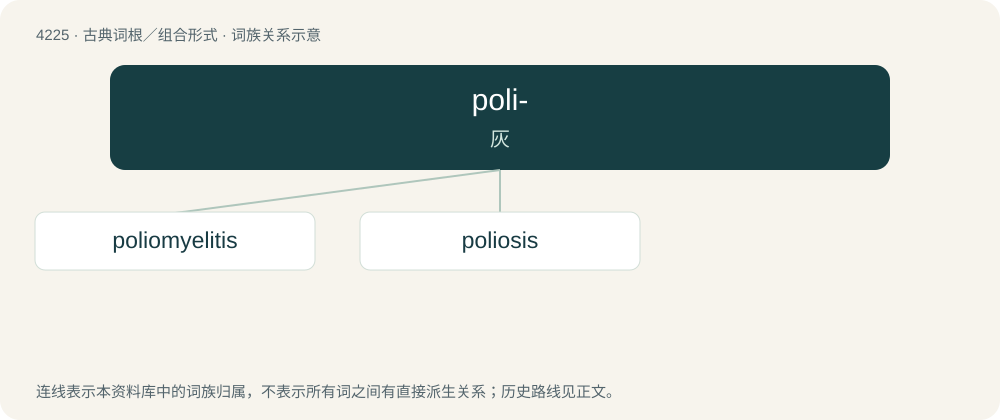

# 4232 · poli- — 灰

[总目录](../00_总目录_按常用程度.md)

**类型**：古典词根／组合形式　｜　**来源语言**：古希腊语

## 核心含义与来源

- 核心含义：灰
- 英文含义：gray, grey
- 词形：poli-

**来源词形**：πολιός (poliós), πολιότης

## 词族图

## 单词速览（常用到不常用）

| 单词 | 音标 | 释义 |
|---|---|---|
| [poliomyelitis](#w-1) | 英 /ˌpɒlɪəʊmaɪəˈlaɪtɪs/ | n. 脊髓灰质炎, 小儿麻痹症；\[医\] 脊髓灰质炎 |
| [poliosis](#w-2) | /,pəuliˈəusis/ | 白发症, 灰发症 |

## 逐词详解

### 1. poliomyelitis

**词性**：名词　｜　**音标**：英 /ˌpɒlɪəʊmaɪəˈlaɪtɪs/

**中文释义**：n. 脊髓灰质炎, 小儿麻痹症；\[医\] 脊髓灰质炎

**英文义项**：Acute infection by the poliovirus, especially of the motor neurons in the spinal cord and brainstem, leading to muscle weakness, paralysis and sometimes deformity.

**词源与演化**：

Borrowed from German Poliomyelitis, from the Ancient Greek πολιός (poliós, “grey”) + μυελός (muelós, “marrow”) + -ῖτις (-îtis, “-itis”). Compare French poliomyélite.

**例句**：

> Poliomyelitis, commonly shortened to polio, is an infectious disease which is highly contagious.

### 2. poliosis

**词性**：名词　｜　**音标**：/,pəuliˈəusis/

**中文释义**：白发症, 灰发症

**英文义项**：The decrease or absence of melanin in head hair, eyebrows, or eyelashes.

**词源与演化**：

From Ancient Greek πολῐός (polĭós, “grey”) + -osis.
