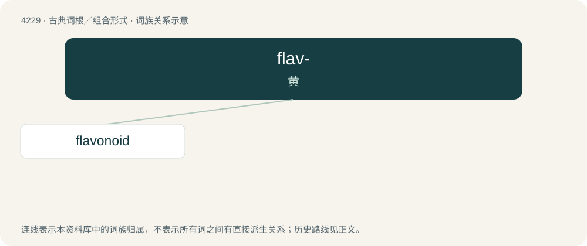

# 4236 · flav- — 黄

[总目录](../00_总目录_按常用程度.md)

**类型**：古典词根／组合形式　｜　**来源语言**：拉丁语

## 核心含义与来源

- 核心含义：黄
- 英文含义：yellow
- 词形：flav-

**来源词形**：flāvus

## 词族图

## 单词速览（常用到不常用）

| 单词 | 音标 | 释义 |
|---|---|---|
| [flavonoid](#w-1) | /ˈfleɪvənɔɪd/ | \[化\] 类黄酮；\[医\] 黄酮类 |

## 逐词详解

### 1. flavonoid

**词性**：名词　｜　**音标**：/ˈfleɪvənɔɪd/

**中文释义**：\[化\] 类黄酮；\[医\] 黄酮类

**英文义项**：Any of many compounds that are plant metabolites, being formally derived from flavone; they have antioxidant properties, and sometimes contribute to flavor.

**构词拆分**：flavone + -oid

**词源与演化**：

From flavone + -oid, from Latin flāvus (“yellow”). Not related to flavor.
