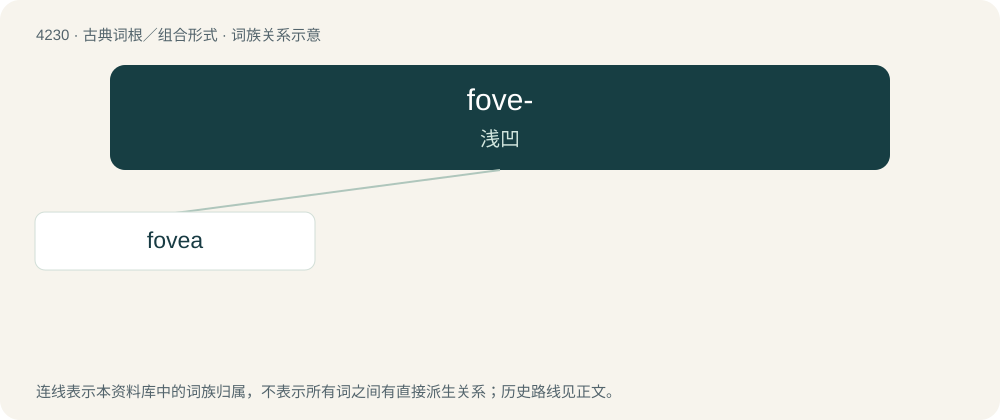

# 4237 · fove- — 浅凹

[总目录](../00_总目录_按常用程度.md)

**类型**：古典词根／组合形式　｜　**来源语言**：拉丁语

## 核心含义与来源

- 核心含义：浅凹
- 英文含义：shallow round depression
- 词形：fove-

**来源词形**：fovea

## 词族图

## 单词速览（常用到不常用）

| 单词 | 音标 | 释义 |
|---|---|---|
| [fovea](#w-1) | /ˈfəʊ.vi.ə/ | n. 窝, 凹；\[医\] 凹 |

## 逐词详解

### 1. fovea

**词性**：名词　｜　**音标**：/ˈfəʊ.vi.ə/

**中文释义**：n. 窝, 凹；\[医\] 凹

**英文义项**：A slight depression or pit in a bone or organ. / The retinal fovea, or fovea centralis, responsible for sharp central vision.

**词源与演化**：

From Latin fovea (“ditch, pit”). Doublet of foiba.
