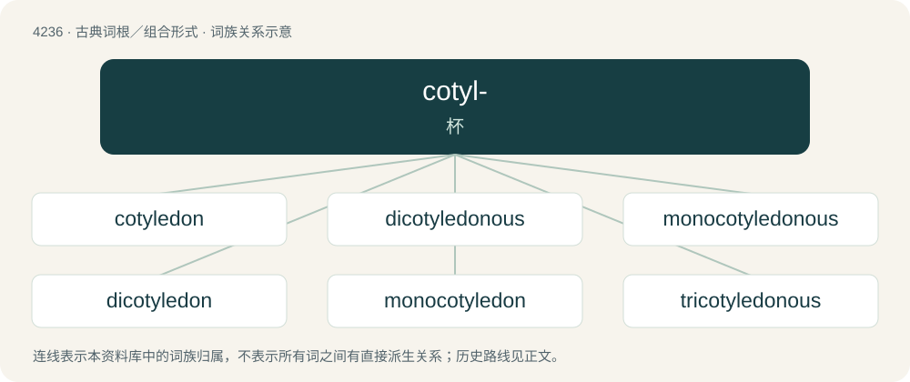

# 4243 · cotyl- — 杯

[总目录](../00_总目录_按常用程度.md)

**类型**：古典词根／组合形式　｜　**来源语言**：古希腊语

## 核心含义与来源

- 核心含义：杯
- 英文含义：cup
- 词形：cotyl-

**来源词形**：κοτύλη (kotúlē)

## 词族图

## 单词速览（常用到不常用）

| 单词 | 音标 | 释义 |
|---|---|---|
| [cotyledon](#w-1) | 英 /ˌkɒt.ɪˈliː.dən/；美 /ˌkɑt.əˈliː.dən/ | n. 子叶, 寇太来顿属植物；\[医\] 绒毛叶; 子叶(植物) |
| [dicotyledonous](#w-2) | /.daikɒtiˈliːdnəs/ | a. 双子叶的 |
| [monocotyledonous](#w-3) | /mɒˈnəʊkɒtɪliːdənəs/ | a. 单子叶植物的 |
| [dicotyledon](#w-4) | /.daikɒtiˈliːdn/ | n. 双子叶植物 |
| [monocotyledon](#w-5) | 英 /ˌmɒnəˌkɒtɪˈliːdən/；/ˌmɑnəˌkɑ.təˈli.dən/ | n. 单子叶植物 |
| [tricotyledonous](#w-6) | /,trikətiˈledənəs/ | a. \[植\]具三子叶的, 三子叶植物的 |

## 逐词详解

### 1. cotyledon

**词性**：名词　｜　**音标**：英 /ˌkɒt.ɪˈliː.dən/；美 /ˌkɑt.əˈliː.dən/

**中文释义**：n. 子叶, 寇太来顿属植物；\[医\] 绒毛叶; 子叶(植物)

**英文义项**：Each of the patches of villi on the foetal chorion in the placenta of ruminants and some other mammals. / The leaf of the embryo of a seed-bearing plant; after germination it becomes the first leaves of the seedling.

**词源与演化**：

From Latin cotylēdōn, from Ancient Greek κοτυληδών (kotulēdṓn, “cup-shaped cavity”), from κοτύλη (kotúlē, “cup”).

### 2. dicotyledonous

**词性**：形容词　｜　**音标**：/.daikɒtiˈliːdnəs/

**中文释义**：a. 双子叶的

**英文义项**：Of or pertaining to the dicotyledons. / Having two cotyledons.

**构词拆分**：dicotyledon + -ous

**词源与演化**：

From dicotyledon + -ous.

### 3. monocotyledonous

**词性**：形容词　｜　**音标**：/mɒˈnəʊkɒtɪliːdənəs/

**中文释义**：a. 单子叶植物的

**英文义项**：Of or pertaining to a flowering plant having a seed with one embryonic leaf (a single cotyledon).

**构词拆分**：mono- + cotyledon + -ous

**词源与演化**：

From mono- + cotyledon + -ous.

### 4. dicotyledon

**词性**：名词　｜　**音标**：/.daikɒtiˈliːdn/

**中文释义**：n. 双子叶植物

**英文义项**：A plant whose seedling has two cotyledons. / Any plant in what used to be the Dicotyledones.

**构词拆分**：di- (“two”) + cotyledon (“embryonic leaf”)

**词源与演化**：

From di- (“two”) + cotyledon (“embryonic leaf”).

**例句**：

> Dicotyledons and monocotyledons together make up the flowering plants, the angiosperms.

该用例对应义项：A plant whose seedling has two cotyledons.

### 5. monocotyledon

**词性**：名词　｜　**音标**：英 /ˌmɒnəˌkɒtɪˈliːdən/；/ˌmɑnəˌkɑ.təˈli.dən/

**中文释义**：n. 单子叶植物

**英文义项**：Any plant whose seedlings typically have one cotyledon (seed leaf) (in contrast to the two cotyledons typical of dicots), thereby belonging to the taxonomic monocots, formerly variously known as Monocotyledones, Monocotyledonae, or Liliopsida, a class in the angiosperms (Angiospermae), the flowering plants.

**构词拆分**：mono- + cotyledon

**词源与演化**：

From mono- + cotyledon.

### 6. tricotyledonous

**词性**：形容词　｜　**音标**：/,trikətiˈledənəs/

**中文释义**：a. \[植\]具三子叶的, 三子叶植物的

**英文义项**：Having three cotyledons.

## 其他候选词

- eudicotyledon
