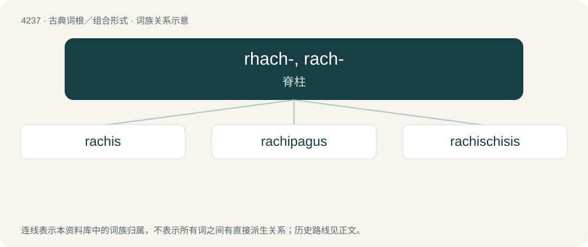

# 4244 · rhach-, rach- — 脊柱

[总目录](../00_总目录_按常用程度.md)

**类型**：古典词根／组合形式　｜　**来源语言**：古希腊语

## 核心含义与来源

- 核心含义：脊柱
- 英文含义：spine
- 词形：rhach-, rach-

**来源词形**：ῥάχις, ῥάχεως (rhákhis, rhákheōs)

## 词族图

## 单词速览（常用到不常用）

| 单词 | 音标 | 释义 |
|---|---|---|
| [rachis](#w-1) | 英 /ˈɹeɪkɪs/ | n. 脊椎, 脊柱, 花序轴；\[医\] 脊柱, 脊椎, 花序轴, 叶轴 |
| [rachipagus](#w-2) |  | \[医\] 脊柱联胎 |
| [rachischisis](#w-3) | /rəˈkiskəsis/ | 脊柱裂, 先天性椎弓不连 |

## 逐词详解

### 1. rachis

**词性**：名词　｜　**音标**：英 /ˈɹeɪkɪs/

**中文释义**：n. 脊椎, 脊柱, 花序轴；\[医\] 脊柱, 脊椎, 花序轴, 叶轴

**英文义项**：The spinal column, or the vertebrae of the spine. / An anatomical shaft or axis in a marine invertebrate.

**词源与演化**：

From New Latin rhachis/rachis, from Ancient Greek ῥάχις (rhákhis, “spine, ridge”).

### 2. rachipagus

**词性**：名词

**中文释义**：\[医\] 脊柱联胎

**英文义项**：A conjoined twin, or a pair of conjoined twins, exhibiting fusion of the back.

**词源与演化**：

By surface analysis, rachi- + -pagus.

### 3. rachischisis

**词性**：名词　｜　**音标**：/rəˈkiskəsis/

**中文释义**：脊柱裂, 先天性椎弓不连

**英文义项**：A developmental birth defect in which the neural tube fails to close completely, leading to motor and sensory deficits, chronic infections, and disturbances in bladder function.

**构词拆分**：rachi- + schisis

**词源与演化**：

From rachi- + schisis.

## 其他候选词

- rhachiodont
- rhachis
