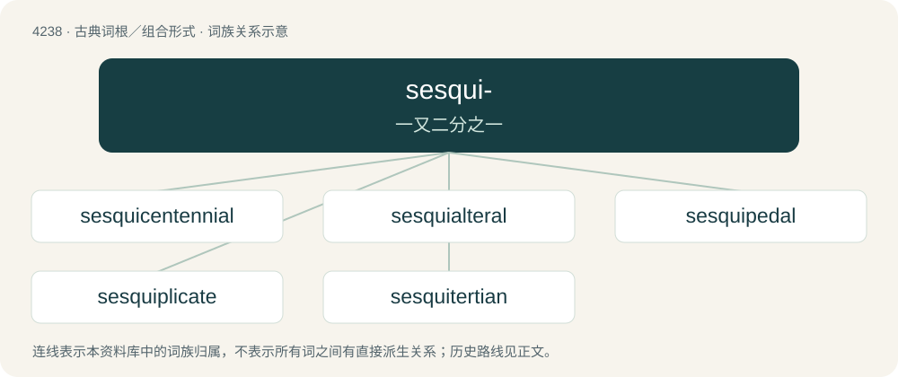

# 4245 · sesqui- — 一又二分之一

[总目录](../00_总目录_按常用程度.md)

**类型**：古典词根／组合形式　｜　**来源语言**：拉丁语

## 核心含义与来源

- 核心含义：一又二分之一
- 英文含义：one and a half
- 词形：sesqui-

**来源词形**：sesqui

## 词族图

## 单词速览（常用到不常用）

| 单词 | 音标 | 释义 |
|---|---|---|
| [sesquicentennial](#w-1) | /ˌsɛskwɪsɛnˈtɛni.əl/ | n. 一百五十周年纪念；a. 一百五十周年纪念的 |
| [sesquialteral](#w-2) | /sɛskwɪˈaltərəl/ | 【英文】Synonym of sesquialterate, 1½ times. |
| [sesquipedal](#w-3) | /sesˈkwipədəl/ | a. 多音节的, 令人厌倦的；n. 冗长的单字 |
| [sesquiplicate](#w-4) | /sesˈkwiplikit,-keit/ | a. \[数\]立方之平方根的,二分之三次方的 |
| [sesquitertian](#w-5) |  | 【英文】Having the ratio of one and one third to one (as 4:3). |

## 逐词详解

### 1. sesquicentennial

**词性**：名词　｜　**音标**：/ˌsɛskwɪsɛnˈtɛni.əl/

**中文释义**：n. 一百五十周年纪念；a. 一百五十周年纪念的

**英文义项**：A 150th anniversary.

**构词拆分**：sesqui- (“one-and-a-half”) + centennial (“of 100 years”)

**词源与演化**：

From sesqui- (“one-and-a-half”) + centennial (“of 100 years”). By surface analysis, sesqui- + cent- + -ennial.

**例句**：

> The city celebrated its sesquicentennial last year.

该用例对应义项：A 150th anniversary.

### 2. sesquialteral

**词性**：形容词　｜　**音标**：/sɛskwɪˈaltərəl/

**英文义项**：Synonym of sesquialterate, 1½ times. / Of or related to sesquialtera, 1½ notes.

**词源与演化**：

From Latin sesquialter + English -al, from sesqui (“a half and a”) + alter (“another, a second”).

### 3. sesquipedal

**词性**：形容词　｜　**音标**：/sesˈkwipədəl/

**中文释义**：a. 多音节的, 令人厌倦的；n. 冗长的单字

**英文义项**：Measuring or containing a foot and a half.

**构词拆分**：sesqui- (“one and a half”) + pedal (“foot, of the foot”)

**词源与演化**：

Borrowed from Latin sesquipedalis; equivalent to sesqui- (“one and a half”) + pedal (“foot, of the foot”).

### 4. sesquiplicate

**词性**：形容词　｜　**音标**：/sesˈkwiplikit,-keit/

**中文释义**：a. \[数\]立方之平方根的,二分之三次方的

**英文义项**：Magnified by one and one-half; in a ratio of three to two.

**构词拆分**：sesqui- (“one and a half”) + plicate (“fold”)

**词源与演化**：

Surface form sesqui- (“one and a half”) + plicate (“fold”); by analogy with duplicate.

### 5. sesquitertian

**词性**：形容词

**英文义项**：Having the ratio of one and one third to one (as 4:3).

**词源与演化**：

From Latin sesquitertius (“containing one and a third”). By surface analysis, sesqui- + tertian.

**用法示例／搭配（非完整句）**：

> a sesquitertian relationship

该用例对应义项：Having the ratio of one and one third to one (as 4:3).
