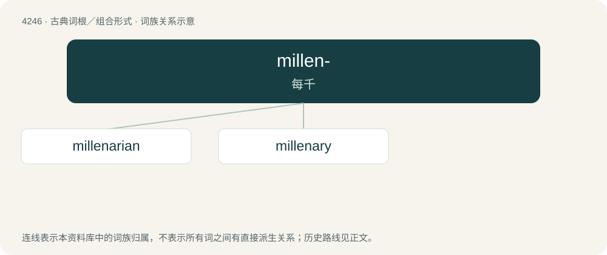

# 4253 · millen- — 每千

[总目录](../00_总目录_按常用程度.md)

**类型**：古典词根／组合形式　｜　**来源语言**：拉丁语

## 核心含义与来源

- 核心含义：每千
- 英文含义：thousand each
- 词形：millen-

**来源词形**：milleni

## 词族图

## 单词速览（常用到不常用）

| 单词 | 音标 | 释义 |
|---|---|---|
| [millenarian](#w-1) | 英 /mɪlɪˈnɛːɹɪən/ | a. 千禧年的, 一千年的；n. 千禧年信徒 |
| [millenary](#w-2) | /ˈmilinəri/ | n. 一千 |

## 逐词详解

### 1. millenarian

**词性**：形容词　｜　**音标**：英 /mɪlɪˈnɛːɹɪən/

**中文释义**：a. 千禧年的, 一千年的；n. 千禧年信徒

**英文义项**：Pertaining to the belief in an impending period of one thousand years of peace and righteousness associated with the Second Coming of Christ and his reign on earth. / Pertaining to any of various religious or social movements which believe in a coming or ongoing radical change to existing world order.

**词源与演化**：

From Late Latin millenarius + English -an.

### 2. millenary

**词性**：形容词　｜　**音标**：/ˈmilinəri/

**中文释义**：n. 一千

**英文义项**：Of or pertaining to a thousand, especially to a thousand years. / Of or pertaining to a millennium; millenarian.

**词源与演化**：

From Latin mīllēnārius.

**例句**：

> Hail, O free homeland, millenary union of fraternal peoples, popular wisdom inherited from our ancestors! Hail, our homeland! We are proud of you!
