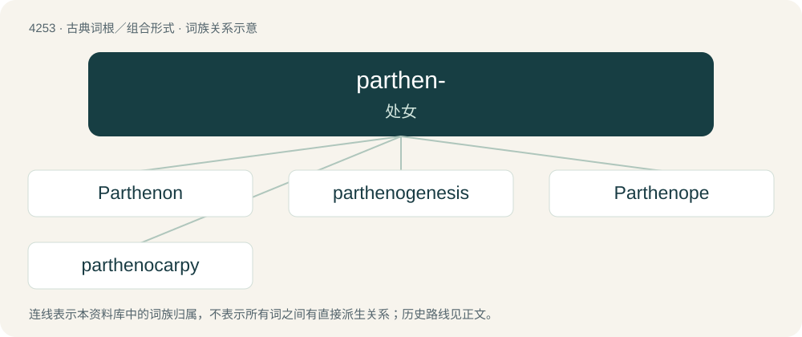

# 4260 · parthen- — 处女

[总目录](../00_总目录_按常用程度.md)

**类型**：古典词根／组合形式　｜　**来源语言**：古希腊语

## 核心含义与来源

- 核心含义：处女
- 英文含义：virgin
- 词形：parthen-

**来源词形**：παρθένος (parthénos)

## 词族图

## 单词速览（常用到不常用）

| 单词 | 音标 | 释义 |
|---|---|---|
| [Parthenon](#w-1) | 英 /ˈpɑːθənən/；美 /ˈpɑːɹθənɑːn/ | n. 帕台农神殿 |
| [parthenogenesis](#w-2) | 英 /ˌpɑːθɪnəʊˈd͡ʒɛnɪsɪs/；美 /ˌpɑɹθɪnoʊˈd͡ʒɛnɪsɪs/ | n. 单性生殖, 孤雌生殖；\[医\] 单性生殖, 孤雌生殖 |
| [Parthenope](#w-3) | /pɑːrˈθɛnəpi/ | n. \[希神\]帕耳忒诺珀( 塞壬女妖之一, 因用歌声迷惑Odysseus不成而投海自尽) |
| [parthenocarpy](#w-4) | /ˈpɑːθinəu,kɑːpi/ | n. \[植\]单性结实 |

## 逐词详解

### 1. Parthenon

**词性**：专有名词　｜　**音标**：英 /ˈpɑːθənən/；美 /ˈpɑːɹθənɑːn/

**中文释义**：n. 帕台农神殿

**英文义项**：An ancient temple to Athena and monument in the city of Athens. It is a symbol of Greek achievement in the arts and of Athenian democracy.

**词源与演化**：

From Ancient Greek Παρθενών (Parthenṓn), from παρθενών (parthenṓn, “women's chamber”), from παρθένος (parthénos, “virgin; young woman”).

**例句**：

> There used to be a giant statue of Athena inside the Parthenon.

### 2. parthenogenesis

**词性**：名词　｜　**音标**：英 /ˌpɑːθɪnəʊˈd͡ʒɛnɪsɪs/；美 /ˌpɑɹθɪnoʊˈd͡ʒɛnɪsɪs/

**中文释义**：n. 单性生殖, 孤雌生殖；\[医\] 单性生殖, 孤雌生殖

**英文义项**：(An instance of) reproduction by the development of a single gamete (an ovum or ovule) without fertilisation by a gamete of the opposite sex; compare monogenesis, metagenesis, and heterogamy. / Asexual reproduction in toto; agamogenesis.

**构词拆分**：partheno- + -genesis

**词源与演化**：

From partheno- + -genesis, from Ancient Greek παρθένος (parthénos, “virgin”) and γένεσις (génesis, “origin, creation, generation”).

### 3. Parthenope

**词性**：专有名词　｜　**音标**：/pɑːrˈθɛnəpi/

**中文释义**：n. \[希神\]帕耳忒诺珀( 塞壬女妖之一, 因用歌声迷惑Odysseus不成而投海自尽)

**英文义项**：One of the sirens, daughter of the god Achelous and the Muse Terpsichore. / Former name of Naples: a port city in southwestern Italy.

**词源与演化**：

From Latin Parthenopē, from Ancient Greek Παρθενόπη (Parthenópē, from παρθένος (parthénos, “virgin, virginal”) + ὄψ (óps, “voice”)).

### 4. parthenocarpy

**词性**：名词　｜　**音标**：/ˈpɑːθinəu,kɑːpi/

**中文释义**：n. \[植\]单性结实

**英文义项**：production of (seedless) fruit without fertilization of ovules.

**构词拆分**：From partheno- + -carp + -y.

**词源与演化**：

From partheno- + -carp + -y.
