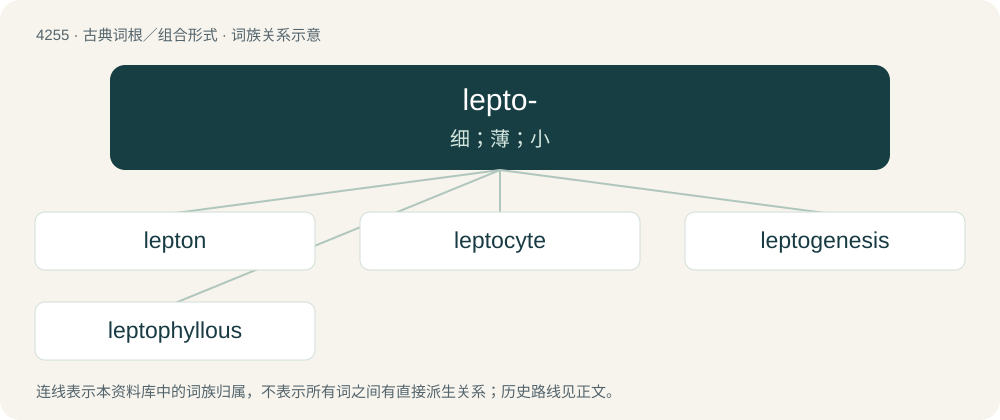

# 4261 · lepto- — 细；薄；小

[总目录](../00_总目录_按常用程度.md)

**类型**：古典词根／组合形式　｜　**来源语言**：古希腊语

## 核心含义与来源

- 核心含义：细；薄；小
- 英文含义：small, fine, thin
- 词形：lepto-

**来源词形**：λεπτός (leptós)

## 词族图

## 单词速览（常用到不常用）

| 单词 | 音标 | 释义 |
|---|---|---|
| [lepton](#w-1) | /ˈlɛptɒn/ | n. 轻子, 雷普顿(希腊货币单位)；\[化\] 轻子 |
| [leptocyte](#w-2) |  | \[医\] 薄红细胞 |
| [leptogenesis](#w-3) | /,leptəuˈdʒenisis/ | 可纺性 |
| [leptophyllous](#w-4) | /,leptəjˈfiləs/ | a. 叶片狭长的 |

## 逐词详解

### 1. lepton

**词性**：名词　｜　**音标**：/ˈlɛptɒn/

**中文释义**：n. 轻子, 雷普顿(希腊货币单位)；\[化\] 轻子

**英文义项**：A coin used since ancient times in Greece, serving in modern times as one hundredth of a phoenix, a drachma, and a euro (as the Greek form of the Eurocent). / A small, bronze Judean coin from the 1st century BCE, considered by some to be the widow's mite.

**词源与演化**：

Derived from Ancient Greek λεπτόν (leptón, “small”). From Ancient Greek λεπτόν (leptón), neuter form of λεπτός (leptós, “small”).

### 2. leptocyte

**词性**：名词

**中文释义**：\[医\] 薄红细胞

**英文义项**：codocyte

**构词拆分**：lepto- + -cyte

**词源与演化**：

From lepto- + -cyte.

### 3. leptogenesis

**词性**：名词　｜　**音标**：/,leptəuˈdʒenisis/

**中文释义**：可纺性

**英文义项**：The differential production of leptons, rather than antileptons, in the early universe

**构词拆分**：lepto- + genesis

**词源与演化**：

From lepto- + genesis.

### 4. leptophyllous

**词性**：形容词　｜　**音标**：/,leptəjˈfiləs/

**中文释义**：a. 叶片狭长的

**英文义项**：Having long, slender leaves

**构词拆分**：lepto- + -phyllous

**词源与演化**：

From lepto- + -phyllous.

## 其他候选词

- Leptomonas
