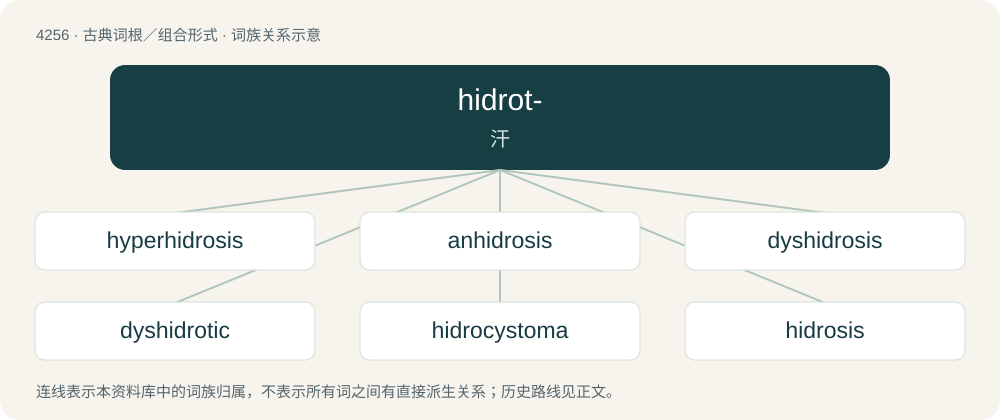

# 4262 · hidrot- — 汗

[总目录](../00_总目录_按常用程度.md)

**类型**：古典词根／组合形式　｜　**来源语言**：古希腊语

## 核心含义与来源

- 核心含义：汗
- 英文含义：sweat
- 词形：hidrot-

**来源词形**：ἱδρώς, ἱδρῶτος (hidrṓs, hidrōtos), ἱδροῦν (hidroûn), ἵδρωσις (hídrōsis)

## 词族图

## 单词速览（常用到不常用）

| 单词 | 音标 | 释义 |
|---|---|---|
| [hyperhidrosis](#w-1) | /,haipə(ː)hiˈdrəusis/ | n. 剧汗, 多汗 |
| [anhidrosis](#w-2) | /,æhaiˈdrəusis/ | n. \[医\]汗缺乏, 缺汗症 |
| [dyshidrosis](#w-3) |  | \[医\] 出汗障碍, \[掌跖\]汗疱 |
| [dyshidrotic](#w-4) |  | 【英文】Having or relating to dyshidrosis. |
| [hidrocystoma](#w-5) |  | \[医\] 汗腺囊瘤 |
| [hidrosis](#w-6) | /haiˈdrəusis/ | n. 排汗；\[医\] 多汗, 出汗 |
| [hidrotic](#w-7) | /haiˈdrɔtik/ | n. 发汗剂；a. 发汗的 |
| [hypohidrosis](#w-8) | /,haipəuhiˈdrəusis/ | n. \[医\]少汗症 |

## 逐词详解

### 1. hyperhidrosis

**词性**：名词　｜　**音标**：/,haipə(ː)hiˈdrəusis/

**中文释义**：n. 剧汗, 多汗

**英文义项**：A medical condition with the primary symptom of excessive sweating, in excess of that required for regulation of body temperature.

**构词拆分**：hyper- + hidrosis

**词源与演化**：

From international scientific vocabulary, from New Latin, from hyper- + hidrosis.

### 2. anhidrosis

**词性**：名词　｜　**音标**：/,æhaiˈdrəusis/

**中文释义**：n. \[医\]汗缺乏, 缺汗症

**英文义项**：The reduced ability or inability to sweat.

**构词拆分**：an- + hidrosis

**词源与演化**：

From an- + hidrosis.

### 3. dyshidrosis

**词性**：名词

**中文释义**：\[医\] 出汗障碍, \[掌跖\]汗疱

**英文义项**：A skin condition characterized by small blisters on the hands or feet.

**构词拆分**：dys- + hidrosis

**词源与演化**：

From dys- + hidrosis, although the name is a misnomer; it was formed by a physician who thought that sweat gland dysfunction was involved, which turned out to be incorrect (for more, see Wikipedia).

### 4. dyshidrotic

**词性**：形容词

**英文义项**：Having or relating to dyshidrosis.

**构词拆分**：dys- + hidrotic

**词源与演化**：

From dys- + hidrotic.

### 5. hidrocystoma

**词性**：名词

**中文释义**：\[医\] 汗腺囊瘤

**英文义项**：An adenoma of the sweat glands.

### 6. hidrosis

**词性**：名词　｜　**音标**：/haiˈdrəusis/

**中文释义**：n. 排汗；\[医\] 多汗, 出汗

**英文义项**：The formation and excretion of sweat. / Excessive sweating; excessive perspiration (more than would be expected in response to a given stimulus; especially when profuse as a symptom of disease or a side effect of a drug).

**词源与演化**：

From New Latin hīdrōsis, from Ancient Greek ῑ̔δρώς (hīdrṓs, “sweat”) + -ωσῐς (-ōsĭs); also synchronically held to end in the suffix -osis.

### 7. hidrotic

**词性**：形容词　｜　**音标**：/haiˈdrɔtik/

**中文释义**：n. 发汗剂；a. 发汗的

**英文义项**：Relating to hidrosis. / Producing hidrosis.

**词源与演化**：

From the Medieval Latin hidrōticus, from the Ancient Greek ἱδρωτικός (hidrōtikós), from ἱδρώς (hidrṓs, “sweat”, stem: ἱδρωτ-); by surface analysis, hidr(osis)- + -otic.

### 8. hypohidrosis

**词性**：名词　｜　**音标**：/,haipəuhiˈdrəusis/

**中文释义**：n. \[医\]少汗症

**英文义项**：diminished sweating: less sweating than would be expected in response to appropriate stimuli.

**构词拆分**：hypo- + hidrosis

**词源与演化**：

From international scientific vocabulary, from New Latin, from hypo- + hidrosis.

## 其他候选词

- hematidrosis
- hidropoiesis
- hidroschesis
