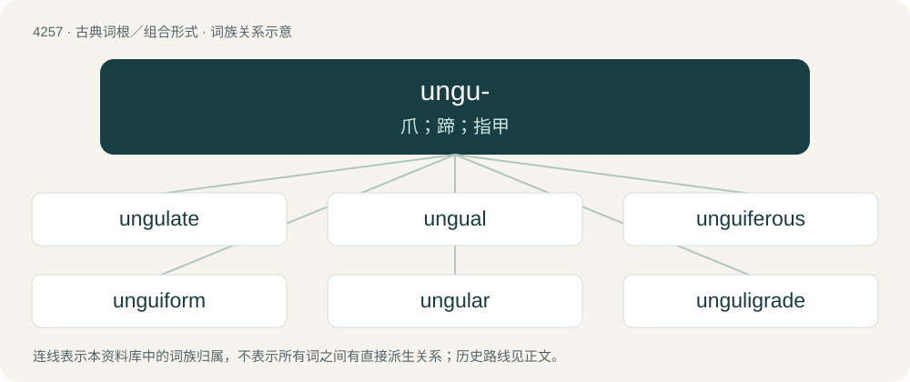

# 4263 · ungu- — 爪；蹄；指甲

[总目录](../00_总目录_按常用程度.md)

**类型**：古典词根／组合形式　｜　**来源语言**：拉丁语

## 核心含义与来源

- 核心含义：爪；蹄；指甲
- 英文含义：claw, hoof, nail
- 词形：ungu-

**来源词形**：unguis, ungula

## 词族图

## 单词速览（常用到不常用）

| 单词 | 音标 | 释义 |
|---|---|---|
| [ungulate](#w-1) | /ˈʌŋɡjʊlɪt/ | a. 蹄状的, 有蹄的, 有蹄类哺乳动物的；n. 有蹄类动物 |
| [ungual](#w-2) | /ˈʌŋɡwəl/ | a. 爪的, 有爪的, 指甲的；\[医\] 指(趾)甲的 |
| [unguiferous](#w-3) |  | 【英文】Producing, having, or supporting nails or claws. |
| [unguiform](#w-4) | /ˈʌn^wifɔːm/ | a. 爪状的 |
| [ungular](#w-5) | /ˈʌŋgjulə/ | a. 爪的 |
| [unguligrade](#w-6) | 英 /ʌŋˈɡjuːlɪˌɡɹeɪd/；美 /ʌŋˈɡjuːləˌɡɹeɪd/ | a. \[动\]蹄行的 |

## 逐词详解

### 1. ungulate

**词性**：名词　｜　**音标**：/ˈʌŋɡjʊlɪt/

**中文释义**：a. 蹄状的, 有蹄的, 有蹄类哺乳动物的；n. 有蹄类动物

**英文义项**：An ungulate animal; a hooved mammal of the clade Euungulata. / A member of the now obsolete clade Ungulata.

**词源与演化**：

From Late Latin ungulātus, from Latin ungula (“hoof”), see -ate (adjective-forming suffix). The noun was substantivized from the adjective through the associated taxon's name (Ungulata), see -ate (noun-forming suffix).

**例句**：

> The majority of large land mammals are ungulates.

该用例对应义项：An ungulate animal; a hooved mammal of the clade Euungulata.

### 2. ungual

**词性**：形容词　｜　**音标**：/ˈʌŋɡwəl/

**中文释义**：a. 爪的, 有爪的, 指甲的；\[医\] 指(趾)甲的

**英文义项**：Pertaining to or resembling a creature's nail, claw or hoof; unguinal.

**词源与演化**：

From Latin unguis (“nail, claw, hoof”) + -al .

### 3. unguiferous

**词性**：形容词

**英文义项**：Producing, having, or supporting nails or claws.

**词源与演化**：

Latin unguis (“nail, claw”) + -ferous.

**用法示例／搭配（非完整句）**：

> unguiferous chela

该用例对应义项：Producing, having, or supporting nails or claws.

### 4. unguiform

**词性**：形容词　｜　**音标**：/ˈʌn^wifɔːm/

**中文释义**：a. 爪状的

**英文义项**：claw-shaped

**词源与演化**：

From Latin unguis + -form.

### 5. ungular

**词性**：形容词　｜　**音标**：/ˈʌŋgjulə/

**中文释义**：a. 爪的

**英文义项**：Of or pertaining to a hoof, claw, or talon.

**构词拆分**：ungula + -ar

**词源与演化**：

From ungula + -ar.

### 6. unguligrade

**词性**：形容词　｜　**音标**：英 /ʌŋˈɡjuːlɪˌɡɹeɪd/；美 /ʌŋˈɡjuːləˌɡɹeɪd/

**中文释义**：a. \[动\]蹄行的

**英文义项**：That walks on hooves.

**词源与演化**：

From Latin ungula (“claw, hoof”) + -grade (“means of walking”) (from Latin gradus). Compare French ongulograde.
