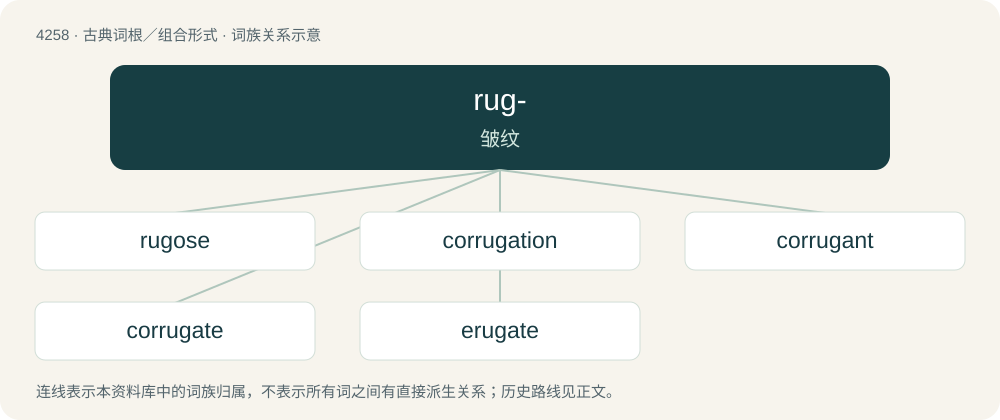

# 4264 · rug- — 皱纹

[总目录](../00_总目录_按常用程度.md)

**类型**：古典词根／组合形式　｜　**来源语言**：拉丁语

## 核心含义与来源

- 核心含义：皱纹
- 英文含义：wrinkle
- 词形：rug-

**来源词形**：rūga, rugare

## 词族图

## 单词速览（常用到不常用）

| 单词 | 音标 | 释义 |
|---|---|---|
| [rugose](#w-1) | 英 /ɹʊˈɡəʊs/；美 /ˌɹuːˈɡoʊs/ | \[医\] 皱褶的, 皱的 |
| [corrugation](#w-2) | /ˌkɔɹ.əˈɡeɪ.ʃən/ | n. 起皱, 波纹, 皱状；\[电\] 波形, 棱皱 |
| [corrugant](#w-3) | /kɒrəˈɡænt/ | \[医\]收敛的 |
| [corrugate](#w-4) | 英 /ˈkɒɹ.ʊˌɡeɪt/；美 /ˈkɔɹ.əˌɡeɪt/ | vt. 使起皱, 成波状；vi. 起皱；a. 有皱的, 起皱的, 波状的 |
| [erugate](#w-5) |  | 【英文】To remove wrinkles from. |

## 逐词详解

### 1. rugose

**词性**：形容词　｜　**音标**：英 /ɹʊˈɡəʊs/；美 /ˌɹuːˈɡoʊs/

**中文释义**：\[医\] 皱褶的, 皱的

**英文义项**：Having rugae or wrinkles, creases, ridges, or corrugation. / Rugged, rough, unrefined.

**词源与演化**：

From Latin rūgōsus (“wrinkled”).

### 2. corrugation

**词性**：名词　｜　**音标**：/ˌkɔɹ.əˈɡeɪ.ʃən/

**中文释义**：n. 起皱, 波纹, 皱状；\[电\] 波形, 棱皱

**英文义项**：The process of corrugating; contraction into wrinkles or alternate ridges and grooves. / washboarding (the appearance of ripples or bumps on a dirt or gravel road)

### 3. corrugant

**词性**：形容词　｜　**音标**：/kɒrəˈɡænt/

**中文释义**：\[医\]收敛的

**英文义项**：Having the power of contracting into wrinkles.

**词源与演化**：

From Latin corrugans, present participle of corrugo (“to wrinkle”), from cor- + ruga (“furrow”).

### 4. corrugate

**词性**：动词　｜　**音标**：英 /ˈkɒɹ.ʊˌɡeɪt/；美 /ˈkɔɹ.əˌɡeɪt/

**中文释义**：vt. 使起皱, 成波状；vi. 起皱；a. 有皱的, 起皱的, 波状的

**英文义项**：To wrinkle (the skin). / To fold into parallel folds, grooves or ridges.

**词源与演化**：

The verb is first attested in 1620, the adjective in 1745; borrowed from Latin corrūgātus, perfect passive participle of Latin corrūgō (“to wrinkle, corrugate”) (see -ate (verb-forming suffix) and -ate (adjective-forming suffix)), from con- + rūga (“wrinkle, crease”) + -ō (verb-forming suffix). Cognate with Spanish acurrucar (“to snuggle; to curl up due to cold; to huddle”).

### 5. erugate

**词性**：动词

**英文义项**：To remove wrinkles from.

**词源与演化**：

From Latin ērūgō, ērūgātus.
