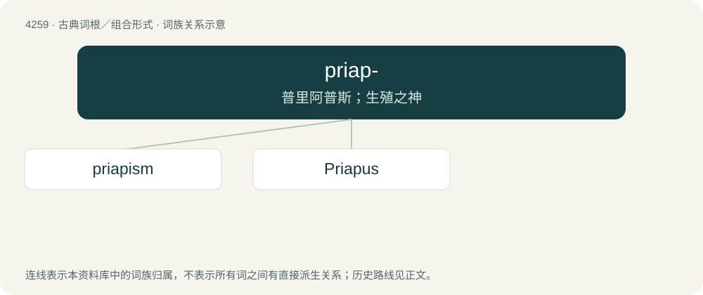

# 4265 · priap- — 普里阿普斯；生殖之神

[总目录](../00_总目录_按常用程度.md)

**类型**：古典词根／组合形式　｜　**来源语言**：古希腊语

## 核心含义与来源

- 核心含义：普里阿普斯；生殖之神
- 词形：priap-

**来源词形**：πριάπος

## 词族图

## 单词速览（常用到不常用）

| 单词 | 音标 | 释义 |
|---|---|---|
| [priapism](#w-1) | 美 /ˈpraɪ.əˌpɪ.zəm/ | n. 阴茎异常勃起, 淫荡行为；\[医\] 阴茎异常勃起 |
| [Priapus](#w-2) | /pɹaɪ̯ˈeɪ̯.pəs/ | \[希、罗神\]男性生殖神(酒神和爱神之子) |

## 逐词详解

### 1. priapism

**词性**：名词　｜　**音标**：美 /ˈpraɪ.əˌpɪ.zəm/

**中文释义**：n. 阴茎异常勃起, 淫荡行为；\[医\] 阴茎异常勃起

**英文义项**：A potentially painful or harmful medical condition in which the erect penis does not return to its flaccid state (despite the absence of both physical and psychological stimulation), often as a result of a spinal injury. / An instance of this.

**词源与演化**：

From Latin priapismus, from Priapus (“the god of procreation, the penis”) + -ism, from Ancient Greek πριαπισμός (priapismós).

### 2. Priapus

**词性**：专有名词　｜　**音标**：/pɹaɪ̯ˈeɪ̯.pəs/

**中文释义**：\[希、罗神\]男性生殖神(酒神和爱神之子)

**英文义项**：The son of Aphrodite and Dionysus, god of procreation, and guardian of gardens and vineyards; personification of the phallus.

**词源与演化**：

From Latin Priāpus, from Ancient Greek Πρίαπος (Príapos).
