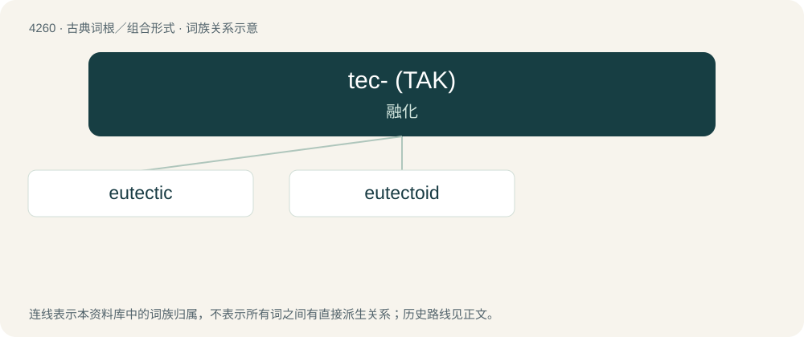

# 4266 · tec- (ΤΑΚ) — 融化

[总目录](../00_总目录_按常用程度.md)

**类型**：古典词根／组合形式　｜　**来源语言**：古希腊语

## 核心含义与来源

- 核心含义：融化
- 英文含义：melt
- 词形：tec-

**来源词形**：τήκειν

## 词族图

## 单词速览（常用到不常用）

| 单词 | 音标 | 释义 |
|---|---|---|
| [eutectic](#w-1) | 美 /juˈtɛk.tɪk/ | a. 容易溶解的, 低共熔的；n. 低共熔混合物 |
| [eutectoid](#w-2) | /juːˈtektɔid/ | n. \[化\]类低共熔体；a. 类低共熔体的, 共析的 |

## 逐词详解

### 1. eutectic

**词性**：形容词　｜　**音标**：美 /juˈtɛk.tɪk/

**中文释义**：a. 容易溶解的, 低共熔的；n. 低共熔混合物

**英文义项**：Describing the chemical composition or temperature of a mixture of substances that gives the lowest temperature at which the mixture becomes fully molten. A further requirement is that that temperature is lower than the melting point of any of the pure component substances. / Describing the thermodynamic equilibrium conditions where a liquid coexists with two solid phases.

**词源与演化**：

From Ancient Greek εὔτηκτος (eútēktos, “easily melted”), from εὖ (eû, “well”) + τήκω (tḗkō, “to melt”). Coined as an adjective (along with the noun eutexia) by British scientist Frederick Guthrie in 1884.

**例句**：

> For a mixture with two components at a fixed pressure, the eutectic reaction can only happen at a fixed chemical composition and temperature, called the eutectic point.

该用例对应义项：Describing the thermodynamic equilibrium conditions where a liquid coexists with two solid phases.

### 2. eutectoid

**词性**：形容词　｜　**音标**：/juːˈtektɔid/

**中文释义**：n. \[化\]类低共熔体；a. 类低共熔体的, 共析的

**英文义项**：Describing the phase-change reaction of an alloy in which, on cooling, a single solid phase transforms into two other solid phases.

**构词拆分**：From eutectic + -oid.

**词源与演化**：

From eutectic + -oid.
