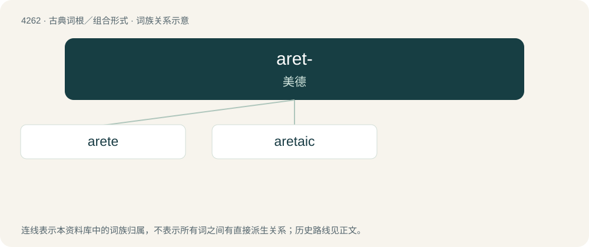

# 4267 · aret- — 美德

[总目录](../00_总目录_按常用程度.md)

**类型**：古典词根／组合形式　｜　**来源语言**：古希腊语

## 核心含义与来源

- 核心含义：美德
- 英文含义：virtue
- 词形：aret-

**来源词形**：ἀρετή, ἀρετῆς (aretḗ, aretês)

## 词族图

## 单词速览（常用到不常用）

| 单词 | 音标 | 释义 |
|---|---|---|
| [arete](#w-1) | /ˈæɹɪtiː/ | n. 险峭的山脊 |
| [aretaic](#w-2) |  | 【英文】Of or pertaining to virtue or excellence. |

## 逐词详解

### 1. arete

**词性**：名词　｜　**音标**：/ˈæɹɪtiː/

**中文释义**：n. 险峭的山脊

**英文义项**：excellence, goodness; virtue. / The proper state or condition for a human.

**词源与演化**：

From Ancient Greek ἀρετή (aretḗ).

### 2. aretaic

**词性**：形容词

**英文义项**：Of or pertaining to virtue or excellence.

**词源与演化**：

From Ancient Greek ἀρετή (aretḗ, “virtue or excellence”).
