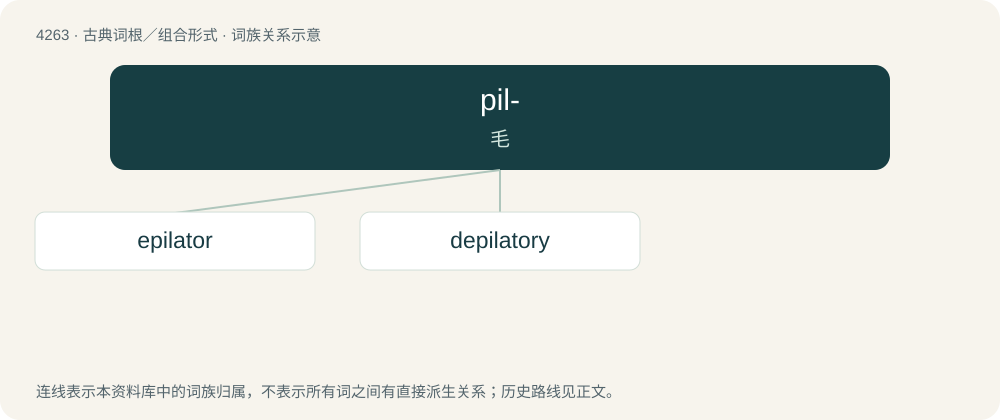

# 4268 · pil- — 毛

[总目录](../00_总目录_按常用程度.md)

**类型**：古典词根／组合形式　｜　**来源语言**：拉丁语

## 核心含义与来源

- 核心含义：毛
- 英文含义：hair
- 词形：pil-

**来源词形**：pilus

## 词族图

## 单词速览（常用到不常用）

| 单词 | 音标 | 释义 |
|---|---|---|
| [epilator](#w-1) | /letə/ | n. 脱毛者, 拔毛者 |
| [depilatory](#w-2) | 英 /dɪˈpɪlətəɹi/；美 /dəˈpɪləˌtɔɹi/ | a. 脱毛用的, 有脱毛作用的；n. 脱毛剂 |

## 逐词详解

### 1. epilator

**词性**：名词　｜　**音标**：/letə/

**中文释义**：n. 脱毛者, 拔毛者

**英文义项**：An electrically-powered device used for hair removal by mechanically grasping multiple hairs simultaneously and pulling them out.

**构词拆分**：epilate + -or

**词源与演化**：

From epilate + -or.

### 2. depilatory

**词性**：形容词　｜　**音标**：英 /dɪˈpɪlətəɹi/；美 /dəˈpɪləˌtɔɹi/

**中文释义**：a. 脱毛用的, 有脱毛作用的；n. 脱毛剂

**英文义项**：That removes hair

**词源与演化**：

From French dépilatoire.

**例句**：

> In the United States, thallium has been restricted from use in rodenticides and depilatory cosmetics.
