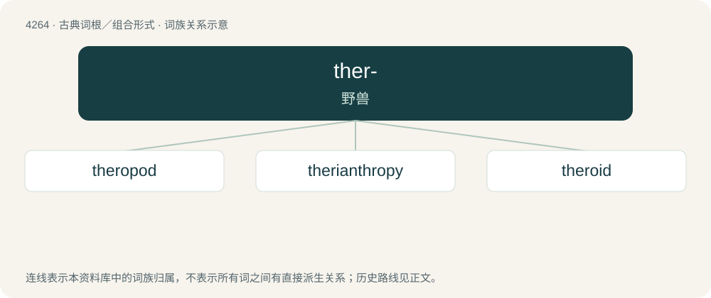

# 4269 · ther- — 野兽

[总目录](../00_总目录_按常用程度.md)

**类型**：古典词根／组合形式　｜　**来源语言**：古希腊语

## 核心含义与来源

- 核心含义：野兽
- 英文含义：beast, animal
- 词形：ther-

**来源词形**：θήρ, θηρός (thḗr, thērós)

## 词族图

## 单词速览（常用到不常用）

| 单词 | 音标 | 释义 |
|---|---|---|
| [theropod](#w-1) | 美 /ˈθɪɚ.əˌpɑd/ | \[古生\] n.兽脚亚目食肉恐龙(前肢小, 主要用后肢行走) ；a. 兽脚亚目的 |
| [therianthropy](#w-2) | /ˌθɛɹiˈænθɹəpi/ | 【英文】Shapeshifting between human and animal forms. |
| [theroid](#w-3) | /ˈθiərɒid/ | a. 野兽般的, 兽性的；\[医\] 兽样的, 兽性的 |

## 逐词详解

### 1. theropod

**词性**：名词　｜　**音标**：美 /ˈθɪɚ.əˌpɑd/

**中文释义**：\[古生\] n.兽脚亚目食肉恐龙(前肢小, 主要用后肢行走) ；a. 兽脚亚目的

**英文义项**：Any bipedal carnivorous dinosaur, of the suborder Theropoda, from the Jurassic and Cretaceous periods.

**构词拆分**：thero- + -pod

**词源与演化**：

From thero- + -pod.

### 2. therianthropy

**词性**：名词　｜　**音标**：/ˌθɛɹiˈænθɹəpi/

**英文义项**：Shapeshifting between human and animal forms. / The characteristic of being a therianthrope; therianism.

### 3. theroid

**词性**：形容词　｜　**音标**：/ˈθiərɒid/

**中文释义**：a. 野兽般的, 兽性的；\[医\] 兽样的, 兽性的

**英文义项**：Bestial, resembling an animal.

**词源与演化**：

From Ancient Greek θήρ (thḗr, “beast, fantastic animal”). Compare Theropoda.

## 其他候选词

- theropsid
