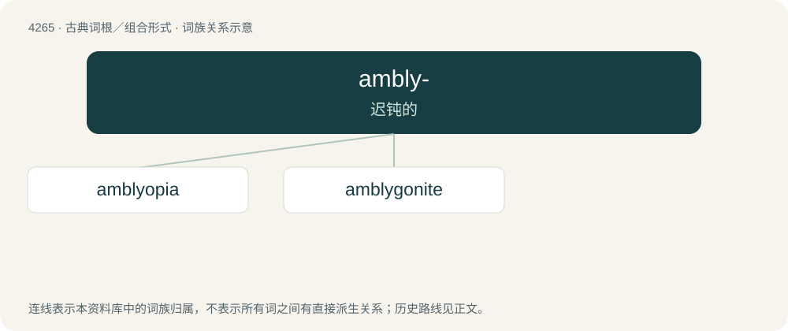

# 4270 · ambly- — 迟钝的

[总目录](../00_总目录_按常用程度.md)

**类型**：古典词根／组合形式　｜　**来源语言**：古希腊语

## 核心含义与来源

- 核心含义：迟钝的
- 英文含义：dull
- 词形：ambly-

**来源词形**：ἀμβλύς (amblús)

## 词族图

## 单词速览（常用到不常用）

| 单词 | 音标 | 释义 |
|---|---|---|
| [amblyopia](#w-1) | /æmblɪˈəʊpɪə/ | n. 弱视；\[医\] 弱视 |
| [amblygonite](#w-2) | /æmˈbli^ənait/ | n. \[矿\]锂磷铝石 |

## 逐词详解

### 1. amblyopia

**词性**：名词　｜　**音标**：/æmblɪˈəʊpɪə/

**中文释义**：n. 弱视；\[医\] 弱视

**英文义项**：Dimness or blurring of the eyesight due to a fault in transmission of signals to the brain from an otherwise healthy eye. / A disorder of visual development in which the brain partially or wholly ignores input from one or both eyes.

**词源与演化**：

Borrowed from New Latin amblyōpia. By surface analysis, ambly- + -ope + -ia.

### 2. amblygonite

**词性**：名词　｜　**音标**：/æmˈbli^ənait/

**中文释义**：n. \[矿\]锂磷铝石

**英文义项**：A mineral, a mixed fluoride and aluminophosphate of sodium and lithium that is an important ore of lithium.

**词源与演化**：

From Ancient Greek ἀμβλύς (amblús, “blunt, dull”) + γωνία (gōnía, “angle, corner”) + -ite. By surface analysis, ambly- + -gon + -ite.

## 其他候选词

- amblygeustia
- Amblypoda
