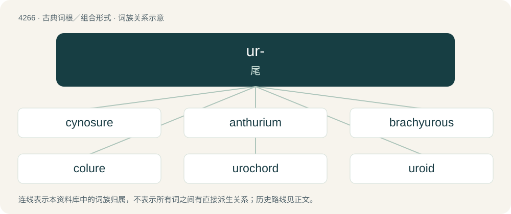

# 4271 · ur- — 尾

[总目录](../00_总目录_按常用程度.md)

**类型**：古典词根／组合形式　｜　**来源语言**：古希腊语

## 核心含义与来源

- 核心含义：尾
- 英文含义：tail
- 词形：ur-

**来源词形**：οὐρά, οὐρᾶς (ourá, ourâs)

## 词族图

## 单词速览（常用到不常用）

| 单词 | 音标 | 释义 |
|---|---|---|
| [cynosure](#w-1) | 英 /ˈsɪnəzjʊə/；美 /ˈsaɪnəʃʊɹ/ | n. 小熊座, 北极星, 众目之的 |
| [anthurium](#w-2) | /ænˈθjjəriəm/ | n. \[植\] 花烛属植物(产于热带美洲) |
| [brachyurous](#w-3) | /,brækiˈjjərəs/ | a. \[动\]短尾亚目的 |
| [colure](#w-4) | /kəˈljuə/ | n. 分至圈 |
| [urochord](#w-5) | /ˈjuərəkɔːd/ | 尾索(尾索类动物的脊索只存在于尾部的一段) |
| [uroid](#w-6) |  | 【英文】The posterior part of a locomotive amoeba. |
| [uropod](#w-7) | /ˈjʊəɹəˌpɒd/ | n. \[动\]尾肢, 尾足, 腹足 |

## 逐词详解

### 1. cynosure

**词性**：名词　｜　**音标**：英 /ˈsɪnəzjʊə/；美 /ˈsaɪnəʃʊɹ/

**中文释义**：n. 小熊座, 北极星, 众目之的

**英文义项**：That which serves to guide or direct; a guiding star. / Something that is the center of attention; an object that serves as a focal point of attraction and admiration.

**词源与演化**：

From Middle French Cynosure (“Ursa Minor; Polaris”), from Latin Cynosūra (“Ursa Minor”), from Ancient Greek Κυνόσουρα (Kunósoura, “Ursa Minor”, literally “dog’s tail”), from κυνός (kunós, “dog's”) + οὐρά (ourá, “tail”).

**用法示例／搭配（非完整句）**：

> let faith be your cynosure to walk by

该用例对应义项：That which serves to guide or direct; a guiding star.

### 2. anthurium

**词性**：名词　｜　**音标**：/ænˈθjjəriəm/

**中文释义**：n. \[植\] 花烛属植物(产于热带美洲)

**英文义项**：Any of several tropical American evergreen plants, of the genus Anthurium, grown for their ornamental leaves and spathes.

**词源与演化**：

Borrowed from taxonomic name Anthurium.

### 3. brachyurous

**词性**：形容词　｜　**音标**：/,brækiˈjjərəs/

**中文释义**：a. \[动\]短尾亚目的

**英文义项**：brachyural

**词源与演化**：

From Latin brachyūrus, from Ancient Greek βραχύουρος (brakhúouros, “short-tailed”), from βραχύς (brakhús, “short”) + οὐρά (ourá, “tail”).

### 4. colure

**词性**：名词　｜　**音标**：/kəˈljuə/

**中文释义**：n. 分至圈

**英文义项**：Either of two great circles (meridians) that intersect at the poles and either the equinoxes or solstices.

**词源与演化**：

From Latin colurus, ultimately from Ancient Greek κόλουρος (kólouros, “truncated, dock-tailed”).

### 5. urochord

**词性**：名词　｜　**音标**：/ˈjuərəkɔːd/

**中文释义**：尾索(尾索类动物的脊索只存在于尾部的一段)

**英文义项**：A notochord that is limited to the caudal region; especially in the Urochordata / Any marine organism of the Urochordata.

**构词拆分**：From uro- + chord.

**词源与演化**：

From uro- + chord.

### 6. uroid

**词性**：名词

**英文义项**：The posterior part of a locomotive amoeba.

### 7. uropod

**词性**：名词　｜　**音标**：/ˈjʊəɹəˌpɒd/

**中文释义**：n. \[动\]尾肢, 尾足, 腹足

**英文义项**：either of the two posterior abdominal appendages of the lobster, shrimp and some other crustaceans. / the hind part of polarized leukocytes, mostly involved in cell-to-cell interaction, cell activation and apoptosis.

**构词拆分**：uro- + -pod

**词源与演化**：

From uro- (“tail”) + -pod (“foot”).

## 其他候选词

- Anura
- Diplura
- Protura
- uroborus
