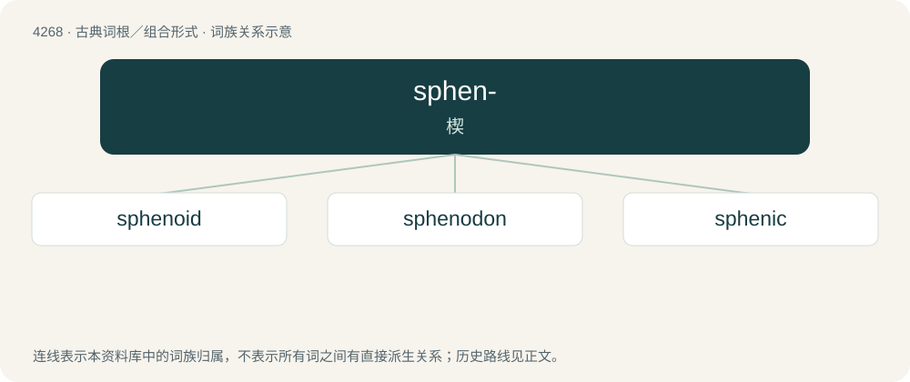

# 4272 · sphen- — 楔

[总目录](../00_总目录_按常用程度.md)

**类型**：古典词根／组合形式　｜　**来源语言**：古希腊语

## 核心含义与来源

- 核心含义：楔
- 英文含义：wedge
- 词形：sphen-

**来源词形**：σφήν, σφηνός (sphḗn, sphēnós)

## 词族图

## 单词速览（常用到不常用）

| 单词 | 音标 | 释义 |
|---|---|---|
| [sphenoid](#w-1) | /ˈsfiː.nɔɪd/ | a. 楔形的；n. 半面晶形, 蝶骨 |
| [sphenodon](#w-2) | /ˈsfiːnə,dɔn/ | n. \[动\]斑点楔齿蜥 |
| [sphenic](#w-3) | /ˈsfenik/ | a. 楔形的, V形的 |

## 逐词详解

### 1. sphenoid

**词性**：形容词　｜　**音标**：/ˈsfiː.nɔɪd/

**中文释义**：a. 楔形的；n. 半面晶形, 蝶骨

**英文义项**：Having a wedge shape. / Of or relating to the sphenoid bone which forms the base of the cranium, behind the eye and below the front part of the brain. It has two pairs of broad lateral ‘wings’ and a number of other projections, and contains two air-filled sinuses.

**词源与演化**：

From New Latin sphenoides, from Ancient Greek σφηνοειδής (sphēnoeidḗs, “wedge-shaped”), from σφήν (sphḗn, “wedge”) + -ειδής (-eidḗs, “-form, -like”).

**例句**：

> The pituitary gland rests in a small depression of the sphenoid bone.

### 2. sphenodon

**词性**：名词　｜　**音标**：/ˈsfiːnə,dɔn/

**中文释义**：n. \[动\]斑点楔齿蜥

**英文义项**：The tuatara. / Any of the other extinct reptiles of the Sphenodontidae family.

**词源与演化**：

From the genus name Sphenodon.

### 3. sphenic

**词性**：形容词　｜　**音标**：/ˈsfenik/

**中文释义**：a. 楔形的, V形的

**英文义项**：Shaped like a wedge.

**词源与演化**：

From Ancient Greek σφήν (sphḗn, “wedge”), + -ic.
