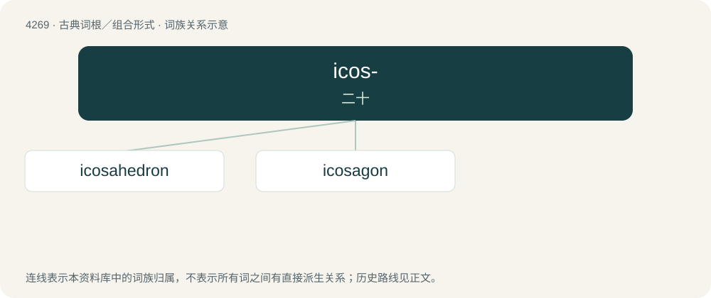

# 4273 · icos- — 二十

[总目录](../00_总目录_按常用程度.md)

**类型**：古典词根／组合形式　｜　**来源语言**：古希腊语

## 核心含义与来源

- 核心含义：二十
- 英文含义：twenty
- 词形：icos-

**来源词形**：ϝεικοσι, εἴκοσι (eíkosi), εἰκοσάς, εἰκοσάκις "twenty times"

## 词族图

## 单词速览（常用到不常用）

| 单词 | 音标 | 释义 |
|---|---|---|
| [icosahedron](#w-1) | /(ˌ)aɪˌkoʊsəˈhiːdɹən/ | n. 二十面体 |
| [icosagon](#w-2) | /aiˈkəusə^ɔn/ | 二十边形, 二十角形 |

## 逐词详解

### 1. icosahedron

**词性**：名词　｜　**音标**：/(ˌ)aɪˌkoʊsəˈhiːdɹən/

**中文释义**：n. 二十面体

**英文义项**：A polyhedron with twenty faces. / A regular icosahedron: one of the Platonic solids, all of whose faces are regular (equilateral) triangles

**构词拆分**：icosa- + -hedron

**词源与演化**：

From Ancient Greek εἰκοσάεδρον (eikosáedron), from εἴκοσι (eíkosi, “twenty”) + ἕδρα (hédra, “face of a geometrical solid”). Equivalent to icosa- + -hedron.

### 2. icosagon

**词性**：名词　｜　**音标**：/aiˈkəusə^ɔn/

**中文释义**：二十边形, 二十角形

**英文义项**：A polygon with twenty sides and twenty angles.

**构词拆分**：icosa- + -gon

**词源与演化**：

From Ancient Greek εἰκοσάγωνος (eikoságōnos, “having twenty sides”), from εἴκοσι (eíkosi, “twenty”) + γωνία (gōnía, “angle”). Equivalent to icosa- + -gon.
