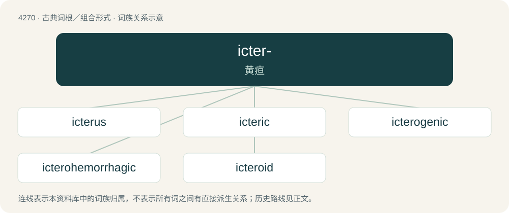

# 4274 · icter- — 黄疸

[总目录](../00_总目录_按常用程度.md)

**类型**：古典词根／组合形式　｜　**来源语言**：古希腊语

## 核心含义与来源

- 核心含义：黄疸
- 英文含义：jaundice
- 词形：icter-

**来源词形**：ἴκτερος (íkteros), ἰκτερικός (ikterikós), ἰκτεριάω

## 词族图

## 单词速览（常用到不常用）

| 单词 | 音标 | 释义 |
|---|---|---|
| [icterus](#w-1) | /ˈɪktəɹəs/ | n. 黄疸；\[医\] 黄疸 |
| [icteric](#w-2) | /ˈiktərik/ | a. 黄疸的；\[医\] 黄疸的 |
| [icterogenic](#w-3) |  | \[医\] 致黄疸的 |
| [icterohemorrhagic](#w-4) |  | 【英文】Characterised by jaundice and hemorrhage |
| [icteroid](#w-5) | /ˈiktərɔid/ | 黄疸样的 |

## 逐词详解

### 1. icterus

**词性**：名词　｜　**音标**：/ˈɪktəɹəs/

**中文释义**：n. 黄疸；\[医\] 黄疸

**英文义项**：An excess of bile pigments in the blood; jaundice. / A yellowish appearance in plants.

**词源与演化**：

From the Latin icterus, from the Ancient Greek ἴκτερος (íkteros, “jaundice”).

### 2. icteric

**词性**：形容词　｜　**音标**：/ˈiktərik/

**中文释义**：a. 黄疸的；\[医\] 黄疸的

**英文义项**：Jaundiced (having icterus); having yellowing of the skin, mucous membranes of the sclerae of the eyes, or other parts of the body. / Relating to jaundice.

**构词拆分**：icterus (“jaundice”) + -ic

**词源与演化**：

From icterus (“jaundice”) + -ic, or Latin ictericus.

### 3. icterogenic

**词性**：形容词

**中文释义**：\[医\] 致黄疸的

**英文义项**：That causes jaundice

**构词拆分**：ictero- + -genic

**词源与演化**：

From ictero- + -genic.

### 4. icterohemorrhagic

**词性**：形容词

**英文义项**：Characterised by jaundice and hemorrhage

**构词拆分**：ictero- + hemorrhagic

**词源与演化**：

From ictero- + hemorrhagic.

### 5. icteroid

**词性**：形容词　｜　**音标**：/ˈiktərɔid/

**中文释义**：黄疸样的

**英文义项**：Marked by jaundice, or having the appearance of that disease

**构词拆分**：ictero- + -oid

**词源与演化**：

From ictero- + -oid.

## 其他候选词

- icterohepatitis
