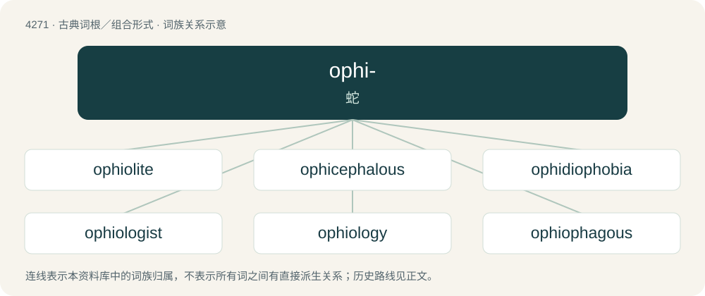

# 4275 · ophi- — 蛇

[总目录](../00_总目录_按常用程度.md)

**类型**：古典词根／组合形式　｜　**来源语言**：古希腊语

## 核心含义与来源

- 核心含义：蛇
- 英文含义：snake
- 词形：ophi-

**来源词形**：ὄφις, ὄφεως (óphis, ópheōs)

## 词族图

## 单词速览（常用到不常用）

| 单词 | 音标 | 释义 |
|---|---|---|
| [ophiolite](#w-1) | /ˈɔfiəlait,ˈəj-/ | n. \[地\]蛇绿岩,蛇纹石 |
| [ophicephalous](#w-2) |  | 蛇头 |
| [ophidiophobia](#w-3) |  | \[医\] 蛇恐怖 |
| [ophiologist](#w-4) |  | n. ophiology的变形 |
| [ophiology](#w-5) | /,ɔfiˈɔlədʒi/ | n. 蛇学 |
| [ophiophagous](#w-6) | /,ɔfiˈɔfə^əs, ,əufi-/ | a. 食蛇的 |
| [ophiophagy](#w-7) |  | 【英文】The eating of snakes. |
| [ophiophobia](#w-8) |  | 【英文】A morbid fear of snakes. |
| [ophitic](#w-9) |  | 辉绿岩结构的; 辉绿状的 |

## 逐词详解

### 1. ophiolite

**词性**：名词　｜　**音标**：/ˈɔfiəlait,ˈəj-/

**中文释义**：n. \[地\]蛇绿岩,蛇纹石

**英文义项**：An assemblage of mafic and ultramafic rock fragments of the ocean lithosphere that has been tectonically moved onto a continental margin or island.

**词源与演化**：

From Ancient Greek ὄφις (óphis, “serpent”) + -lite.

### 2. ophicephalous

**词性**：形容词

**中文释义**：蛇头

**英文义项**：snake-headed

**构词拆分**：ophio- + -cephalous

**词源与演化**：

From ophio- + -cephalous.

### 3. ophidiophobia

**词性**：名词

**中文释义**：\[医\] 蛇恐怖

**英文义项**：Ophiophobia; a fear of snakes.

**构词拆分**：ophidio- + -phobia

**词源与演化**：

From Ancient Greek ὄφις (óphis, “serpent”) + -phobia, equivalent to ophidio- + -phobia.

### 4. ophiologist

**词性**：名词

**中文释义**：n. ophiology的变形

**英文义项**：One who studies ophiology; an expert on snakes.

**构词拆分**：ophiology + -ist

**词源与演化**：

From ophiology + -ist.

### 5. ophiology

**词性**：名词　｜　**音标**：/,ɔfiˈɔlədʒi/

**中文释义**：n. 蛇学

**英文义项**：The study of snakes, a branch of herpetology.

**构词拆分**：ophio- (“snake”) + -logy (“study of”)

**词源与演化**：

From ophio- (“snake”) + -logy (“study of”).

### 6. ophiophagous

**词性**：形容词　｜　**音标**：/,ɔfiˈɔfə^əs, ,əufi-/

**中文释义**：a. 食蛇的

**英文义项**：Feeding on snakes.

**构词拆分**：ophio- (“snake”) + -phagous (“eating”)

**词源与演化**：

From ophio- (“snake”) + -phagous (“eating”).

### 7. ophiophagy

**词性**：名词

**英文义项**：The eating of snakes.

**构词拆分**：ophio- + -phagy

**词源与演化**：

From ophio- + -phagy.

### 8. ophiophobia

**词性**：名词

**英文义项**：A morbid fear of snakes.

**构词拆分**：ophio- (“snake”) + -phobia (“fear of”)

**词源与演化**：

From ophio- (“snake”) + -phobia (“fear of”).

### 9. ophitic

**词性**：形容词

**中文释义**：辉绿岩结构的; 辉绿状的

**英文义项**：Having crystals of feldspar interspersed with plates of augite.

**构词拆分**：ophite + -ic

**词源与演化**：

From ophite + -ic.

## 其他候选词

- Brachyurophis
- Ophicephalus
- Ophiceras
- Ophiclinus
- Ophiophagus
- Ophisaurus
- Ophisops
