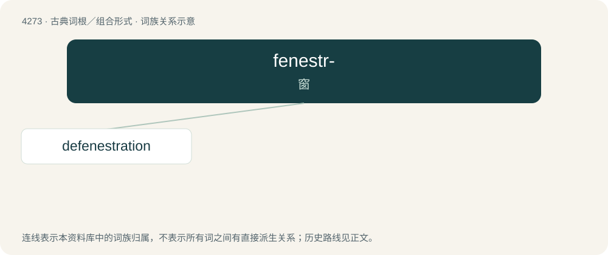

# 4276 · fenestr- — 窗

[总目录](../00_总目录_按常用程度.md)

**类型**：古典词根／组合形式　｜　**来源语言**：拉丁语

## 核心含义与来源

- 核心含义：窗
- 英文含义：window
- 词形：fenestr-

**来源词形**：fenestra

## 词族图

## 单词速览（常用到不常用）

| 单词 | 音标 | 释义 |
|---|---|---|
| [defenestration](#w-1) | 英 /dɪˌfɛnɪˈstɹeɪʃ(ə)n/；美 /diˌfɛnəˈstɹeɪʃən/ | n. 丢出窗外 |

## 逐词详解

### 1. defenestration

**词性**：名词　｜　**音标**：英 /dɪˌfɛnɪˈstɹeɪʃ(ə)n/；美 /diˌfɛnəˈstɹeɪʃən/

**中文释义**：n. 丢出窗外

**英文义项**：The act of throwing something or especially someone out of a window, especially lethally. / The high-profile removal of a person from an organization.

**词源与演化**：

From New Latin defenestratio, from dē (“from; out”) + fenestra (“window”) + -atio (suffix indicating an action or process); compare Middle French défenestrer (modern French défenestrer), défenestration, Italian defenestrazione and German Fenstersturz. The verb defenestrate was formed later.

**例句**：

> The immediate defenestration of humanistic culture can't be a random project.
