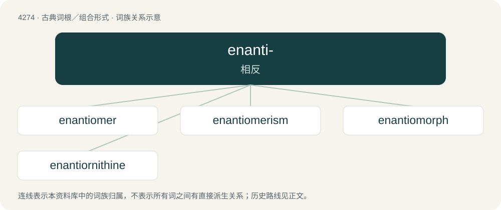

# 4277 · enanti- — 相反

[总目录](../00_总目录_按常用程度.md)

**类型**：古典词根／组合形式　｜　**来源语言**：古希腊语

## 核心含义与来源

- 核心含义：相反
- 英文含义：opposite
- 词形：enanti-

**来源词形**：ἐναντίος (enantíos)

## 词族图

## 单词速览（常用到不常用）

| 单词 | 音标 | 释义 |
|---|---|---|
| [enantiomer](#w-1) | 英 /ɛˈnænti.əmər/ | \[化\] 对映体; 对映异构体 |
| [enantiomerism](#w-2) | /iˈnæntiə,merizm/ | 光学异构现象 |
| [enantiomorph](#w-3) | /iˈnæntiəumɔːf/ | n. \[化\]对映结构体；n. \[化\]对映(结构)体 |
| [enantiornithine](#w-4) | /ɪˌnæntiˈɔː(ɹ)nɪθaɪn/ | 【英文】Any of an extinct group of protobirds of the Enantiornithes. |

## 逐词详解

### 1. enantiomer

**词性**：名词　｜　**音标**：英 /ɛˈnænti.əmər/

**中文释义**：\[化\] 对映体; 对映异构体

**英文义项**：One of a pair of stereoisomers that is the mirror image of the other, but may not be superimposed on this other stereoisomer.

**构词拆分**：enantio- + -mer

**词源与演化**：

From enantio- + -mer.

### 2. enantiomerism

**词性**：名词　｜　**音标**：/iˈnæntiə,merizm/

**中文释义**：光学异构现象

**英文义项**：The isomerism of enantiomers.

**构词拆分**：enantiomer + -ism

**词源与演化**：

From enantiomer + -ism.

### 3. enantiomorph

**词性**：名词　｜　**音标**：/iˈnæntiəumɔːf/

**中文释义**：n. \[化\]对映结构体；n. \[化\]对映(结构)体

**英文义项**：A mirror image, a form related to another as an object is to its image in a mirror. / Either of a pair of crystals that are mirror images of each other, and are optically active.

**词源与演化**：

From Ancient Greek ἐναντίος (enantíos, “opposite”) + μορφή (morphḗ, “form”). By surface analysis, enantio- + -morph.

### 4. enantiornithine

**词性**：名词　｜　**音标**：/ɪˌnæntiˈɔː(ɹ)nɪθaɪn/

**英文义项**：Any of an extinct group of protobirds of the Enantiornithes.

**词源与演化**：

From enanti- + + Ancient Greek ὄρνιθος (órnithos, “bird”) + -ine.
