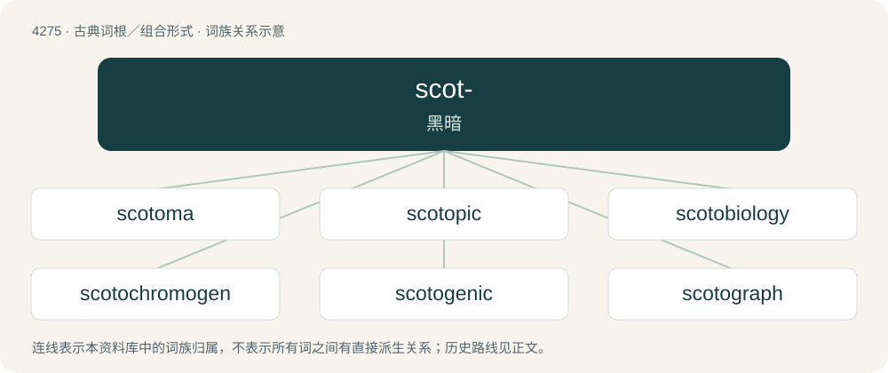

# 4278 · scot- — 黑暗

[总目录](../00_总目录_按常用程度.md)

**类型**：古典词根／组合形式　｜　**来源语言**：古希腊语

## 核心含义与来源

- 核心含义：黑暗
- 英文含义：darkness
- 词形：scot-

**来源词形**：σκότος, σκότου, σκοταῖος

## 词族图

## 单词速览（常用到不常用）

| 单词 | 音标 | 释义 |
|---|---|---|
| [scotoma](#w-1) | /skəˈtoʊ.mə/ | n. 暗点, 盲点；\[医\] 暗点, 盲点 |
| [scotopic](#w-2) | 英 /skə(ʊ)ˈtɒp.ɪk/；美 /skəˈtoʊ.pɪk/ | a. \[医\]暗适应的,暗视的 |
| [scotobiology](#w-3) |  | 【英文】The study of the effects of darkness on living organisms, and on biological processes. |
| [scotochromogen](#w-4) |  | 【英文】A microorganism whose pigmentation develops in the dark as well as in the light. |
| [scotogenic](#w-5) |  | 【英文】Created from dark matter |
| [scotograph](#w-6) | /ˈskɒtəgrɑːf/ | n. 射线照片；\[医\] X线\[照\]片, 暗室显影片, 暗中写字器 |
| [scotoperiod](#w-7) |  | 【英文】The period of darkness, or absence of daylight, experienced by an organism. |
| [scotophase](#w-8) | /ˈskɔtəfeis, ˈskəj-/ | n. \[生\]人工黑暗期,人工夜间 |
| [scotophilic](#w-9) | /,skɔtəˈfilik, ,skəj-/ | a. \[生\]适暗的,喜暗的 |
| [scotophobe](#w-10) |  | 【英文】One who fears darkness. |
| [scotophobia](#w-11) | /,skɔtəˈfəubjə/ | n. 暗影恐怖 |
| [scotophobic](#w-12) | /,skɔtəjˈfəjbik, ,skəj-/ | a. \[生化\]恐暗肽的,具恐暗肽的 |
| [scotoscope](#w-13) | /ˈskɔtəskəup/ | \[电\] 增辉望远镜 |
| [scotosis](#w-14) |  | \[医\] 暗点, 盲点 |
| [scototactic](#w-15) |  | 【英文】Relating to scototaxis |
| [scototaxis](#w-16) |  | 【英文】A preference for, and subsequent movement towards darkness. |
| [scototherapy](#w-17) |  | \[医\] 蔽光疗法 |

## 逐词详解

### 1. scotoma

**词性**：名词　｜　**音标**：/skəˈtoʊ.mə/

**中文释义**：n. 暗点, 盲点；\[医\] 暗点, 盲点

**英文义项**：An area of impaired or lost vision within a visual field otherwise in a good (or at least healthy) state. / A weakness of the mind's perception, cognition, or world view, causing it to ignore some aspects of reality.

**词源与演化**：

From Late Latin scotoma, from Ancient Greek σκότωμα (skótōma), from σκότος (skótos, “darkness”). By surface analysis, scot- + -oma. The figurative sense is an extension from the literal sense, as if the mind, like an eye, cannot "see" certain things.

**用法示例／搭配（非完整句）**：

> intellectual scotoma

该用例对应义项：A weakness of the mind's perception, cognition, or world view, causing it to ignore some aspects of reality.

### 2. scotopic

**词性**：形容词　｜　**音标**：英 /skə(ʊ)ˈtɒp.ɪk/；美 /skəˈtoʊ.pɪk/

**中文释义**：a. \[医\]暗适应的,暗视的

**英文义项**：Relating to or denoting vision in dim light, believed to involve chiefly the rods of the retina.

**构词拆分**：scotopia + -ic

**词源与演化**：

From scotopia + -ic.

**用法示例／搭配（非完整句）**：

> scotopic vision

该用例对应义项：Relating to or denoting vision in dim light, believed to involve chiefly the rods of the retina.

### 3. scotobiology

**词性**：名词

**英文义项**：The study of the effects of darkness on living organisms, and on biological processes.

**构词拆分**：scoto- + biology

**词源与演化**：

From scoto- + biology.

### 4. scotochromogen

**词性**：名词

**英文义项**：A microorganism whose pigmentation develops in the dark as well as in the light.

**构词拆分**：scoto- + chromogen

**词源与演化**：

From scoto- + chromogen.

### 5. scotogenic

**词性**：形容词

**英文义项**：Created from dark matter

**构词拆分**：scoto- + -genic

**词源与演化**：

From scoto- + -genic.

### 6. scotograph

**词性**：名词　｜　**音标**：/ˈskɒtəgrɑːf/

**中文释义**：n. 射线照片；\[医\] X线\[照\]片, 暗室显影片, 暗中写字器

**英文义项**：An instrument for writing in the dark, or by the blind. / An impression made on a photographic plate by a radioactive substance without the intervention of any opaque object other than the screen of the plate.

**构词拆分**：scoto- + -graph

**词源与演化**：

From scoto- + -graph.

### 7. scotoperiod

**词性**：名词

**英文义项**：The period of darkness, or absence of daylight, experienced by an organism.

**构词拆分**：scoto- + period

**词源与演化**：

From scoto- + period.

### 8. scotophase

**词性**：名词　｜　**音标**：/ˈskɔtəfeis, ˈskəj-/

**中文释义**：n. \[生\]人工黑暗期,人工夜间

**英文义项**：The dark phase in a cycle of light and darkness, especially artificially induced.

**构词拆分**：scoto- + phase

**词源与演化**：

From scoto- + phase.

### 9. scotophilic

**词性**：形容词　｜　**音标**：/,skɔtəˈfilik, ,skəj-/

**中文释义**：a. \[生\]适暗的,喜暗的

**英文义项**：That thrives in darkness or low light levels

**构词拆分**：scoto- + -philic

**词源与演化**：

From scoto- + -philic.

### 10. scotophobe

**词性**：名词

**英文义项**：One who fears darkness.

**构词拆分**：scoto- + -phobe

**词源与演化**：

From scoto- + -phobe.

### 11. scotophobia

**词性**：名词　｜　**音标**：/,skɔtəˈfəubjə/

**中文释义**：n. 暗影恐怖

**英文义项**：Fear of darkness.

**构词拆分**：scoto- + -phobia

**词源与演化**：

From scoto- + -phobia.

### 12. scotophobic

**词性**：形容词　｜　**音标**：/,skɔtəjˈfəjbik, ,skəj-/

**中文释义**：a. \[生化\]恐暗肽的,具恐暗肽的

**英文义项**：Fearing darkness.

**构词拆分**：scoto- + -phobic

**词源与演化**：

From scoto- + -phobic.

### 13. scotoscope

**词性**：名词　｜　**音标**：/ˈskɔtəskəup/

**中文释义**：\[电\] 增辉望远镜

**英文义项**：Any instrument for viewing objects in the dark or in a faint light.

**构词拆分**：scoto- + -scope

**词源与演化**：

From scoto- + -scope.

### 14. scotosis

**词性**：名词

**中文释义**：\[医\] 暗点, 盲点

**英文义项**：Intellectual blindness: a hardening of the mind against unwanted wisdom.

**构词拆分**：scoto- + -osis

**词源与演化**：

From scoto- + -osis.

### 15. scototactic

**词性**：形容词

**英文义项**：Relating to scototaxis

### 16. scototaxis

**词性**：名词

**英文义项**：A preference for, and subsequent movement towards darkness.

**构词拆分**：scoto- + taxis

**词源与演化**：

From scoto- + taxis.

### 17. scototherapy

**词性**：名词

**中文释义**：\[医\] 蔽光疗法

**英文义项**：Therapeutic use of darkness, once proposed to treat malaria and more recently to treat sleep disorders and depression.

**构词拆分**：scoto- + therapy

**词源与演化**：

From scoto- + therapy.

## 其他候选词

- scotophilia
- scotophobotaxis
