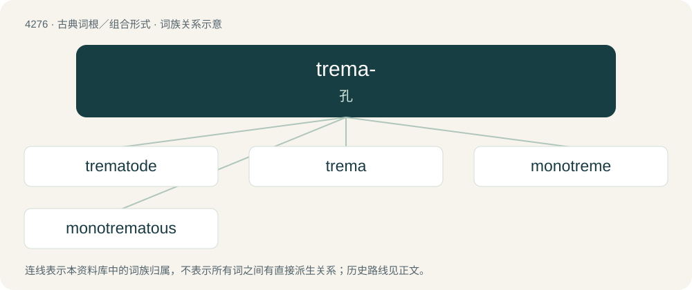

# 4279 · trema- — 孔

[总目录](../00_总目录_按常用程度.md)

**类型**：古典词根／组合形式　｜　**来源语言**：古希腊语

## 核心含义与来源

- 核心含义：孔
- 英文含义：hole
- 词形：trema-

**来源词形**：τετραίνω, τρῆμα (trêma)

## 词族图

## 单词速览（常用到不常用）

| 单词 | 音标 | 释义 |
|---|---|---|
| [trematode](#w-1) | 英 /ˈtrɛm.ə.təʊd/；美 /ˈtrɛm.əˌtoʊd/ | n. 吸虫；\[医\] 吸虫 |
| [trema](#w-2) | /ˈtɹiː.mə/ | 两点符(¨)(一种区别发音的符号, 如法语的naВf, 这表示邻近的两个元音不构成二合元音) |
| [monotreme](#w-3) | /ˈmɒnətɹiːm/ | n. 单孔目动物；\[医\] 单孔类 |
| [monotrematous](#w-4) | /.mɒnəuˈtremətəs/ | a. 单孔目的 |

## 逐词详解

### 1. trematode

**词性**：名词　｜　**音标**：英 /ˈtrɛm.ə.təʊd/；美 /ˈtrɛm.əˌtoʊd/

**中文释义**：n. 吸虫；\[医\] 吸虫

**英文义项**：a parasitic flatworm of the class Trematoda

**词源与演化**：

From translingual Trematoda, from Ancient Greek τρημᾰτώδης (trēmătṓdēs, “having a vent to the intestinal canal”), from τρῆμᾰ (trêmă, “perforation, aperture”) + -ώδης (-ṓdēs, “full of, -like”). See also -ode.

### 2. trema

**词性**：名词　｜　**音标**：/ˈtɹiː.mə/

**中文释义**：两点符(¨)(一种区别发音的符号, 如法语的naВf, 这表示邻近的两个元音不构成二合元音)

**英文义项**：A diacritic consisting of two dots ( ¨ ) placed over a letter, used among other things to indicate umlaut or diaeresis.

**词源与演化**：

From Ancient Greek τρῆμα (trêma, “hole”), from τετραίνω (tetraínō, “perforate”), used for the dots on dice, via Dutch trema and French tréma.

### 3. monotreme

**词性**：名词　｜　**音标**：/ˈmɒnətɹiːm/

**中文释义**：n. 单孔目动物；\[医\] 单孔类

**英文义项**：Any of the order Monotremata of mammals that lay eggs and have single orifices for urogenital and digestive functions (cloaca); an echidna, platypus or one of their extinct relatives.

**词源与演化**：

From mono- (“one”) + -treme (“hole”).

### 4. monotrematous

**词性**：形容词　｜　**音标**：/.mɒnəuˈtremətəs/

**中文释义**：a. 单孔目的

**英文义项**：Of or pertaining to the Monotremata or monotremes.

**词源与演化**：

Monotremata + -ous

## 其他候选词

- tréma
