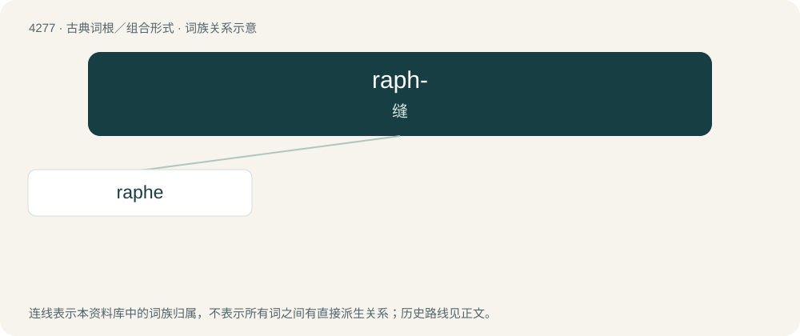

# 4280 · raph- — 缝

[总目录](../00_总目录_按常用程度.md)

**类型**：古典词根／组合形式　｜　**来源语言**：古希腊语

## 核心含义与来源

- 核心含义：缝
- 英文含义：sew, seam
- 词形：raph-

**来源词形**：ῥάπτειν (rháptein), ῤαφή (raphḗ)

## 词族图

## 单词速览（常用到不常用）

| 单词 | 音标 | 释义 |
|---|---|---|
| [raphe](#w-1) | /ˈɹeɪ.fi/ | \[医\] 缝\[际\], 种脊(植) |

## 逐词详解

### 1. raphe

**词性**：名词　｜　**音标**：/ˈɹeɪ.fi/

**中文释义**：\[医\] 缝\[际\], 种脊(植)

**英文义项**：A seamlike ridge or furrow on an organ, bodily tissue, or other structure, typically marking the line where two halves or sections fused in the embryo. / The connecting ridge between the two halves of the medulla oblongata or the tegmentum of the midbrain.

**词源与演化**：

Borrowed from New Latin raphē, from Ancient Greek ῥᾰφή (rhăphḗ, “seam; suture”).

## 其他候选词

- raphae
