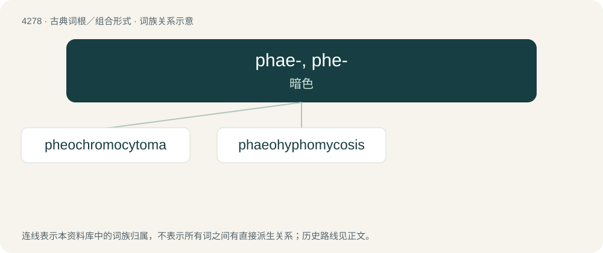

# 4281 · phae-, phe- — 暗色

[总目录](../00_总目录_按常用程度.md)

**类型**：古典词根／组合形式　｜　**来源语言**：古希腊语

## 核心含义与来源

- 核心含义：暗色
- 英文含义：dark
- 词形：phae-, phe-

**来源词形**：φαιός (phaiós)

## 词族图

## 单词速览（常用到不常用）

| 单词 | 音标 | 释义 |
|---|---|---|
| [pheochromocytoma](#w-1) | /,fiːəkrəuməsaiˈtəumə/ | n. \[医\]嗜铬细胞瘤( 一种交感神经系统的肿瘤) |
| [phaeohyphomycosis](#w-2) |  | 【英文】Any of a heterogeneous group of mycotic infections caused by dematiaceous fungi. |

## 逐词详解

### 1. pheochromocytoma

**词性**：名词　｜　**音标**：/,fiːəkrəuməsaiˈtəumə/

**中文释义**：n. \[医\]嗜铬细胞瘤( 一种交感神经系统的肿瘤)

**英文义项**：A neuroendocrine tumour of the medulla of the adrenal glands.

**构词拆分**：pheochromocyte + -oma

**词源与演化**：

From pheochromocyte + -oma. By surface analysis, pheo- + -chrome + -o- + -cyte + -oma. Coined by Ludwig Pick in 1912.

### 2. phaeohyphomycosis

**词性**：名词

**英文义项**：Any of a heterogeneous group of mycotic infections caused by dematiaceous fungi.

## 其他候选词

- phaeomelanin
- pheochrome
