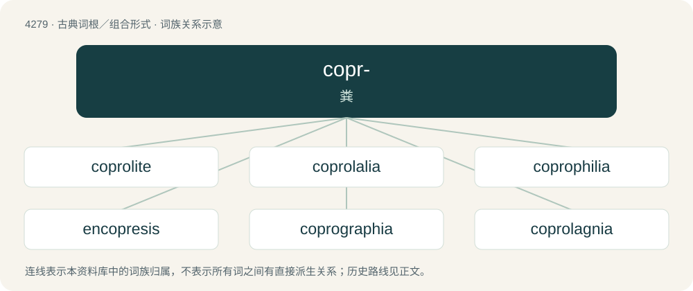

# 4282 · copr- — 粪

[总目录](../00_总目录_按常用程度.md)

**类型**：古典词根／组合形式　｜　**来源语言**：古希腊语

## 核心含义与来源

- 核心含义：粪
- 英文含义：dung
- 词形：copr-

**来源词形**：κόπρος (kópros)

## 词族图

## 单词速览（常用到不常用）

| 单词 | 音标 | 释义 |
|---|---|---|
| [coprolite](#w-1) | 英 /ˈkɒprəˌlaɪt/；美 /ˈkɑprəˌlaɪt/ | n. 粪化石；\[化\] 粪化石 |
| [coprolalia](#w-2) | 美 /ˌkɑpɹəˈleɪliə/ | n. 秽语症, 污秽言语 |
| [coprophilia](#w-3) | /.kɒprəˈfiliə/ | n. 粪便嗜好症；\[医\] 嗜粪癖 |
| [encopresis](#w-4) | /en,kəjˈpriːsis/ | n. \[医\](因器官缺损或疾病所导致的)大便失禁 |
| [coprographia](#w-5) |  | 【英文】The making of vulgar writings or drawings, especially when done involuntarily. |
| [coprolagnia](#w-6) | 英 /ˌkɒp.rəˈlæɡ.niə/ | \[医\] 粪性色情 |
| [coprolith](#w-7) |  | \[医\] 粪石 |
| [coprology](#w-8) | /kɒˈprɒlədʒi/ | n. 色情文学；\[医\] 粪便学 |
| [coprophagy](#w-9) |  | \[医\] 食粪癖 |
| [copropraxia](#w-10) | /kɔprəˈprækʃiə/ | 秽亵行为 |
| [encopretic](#w-11) |  | 【英文】Relating to, or exhibiting, encopresis. |

## 逐词详解

### 1. coprolite

**词性**：名词　｜　**音标**：英 /ˈkɒprəˌlaɪt/；美 /ˈkɑprəˌlaɪt/

**中文释义**：n. 粪化石；\[化\] 粪化石

**英文义项**：A fossil consisting of petrified dung.

**构词拆分**：copro- + -lite

**词源与演化**：

From copro- + -lite.

**例句**：

> Mary's main claim to fame was her discovery of the largest coprolite to ever be discovered.

### 2. coprolalia

**词性**：名词　｜　**音标**：美 /ˌkɑpɹəˈleɪliə/

**中文释义**：n. 秽语症, 污秽言语

**英文义项**：The uncontrolled use of abusive, obscene or scatological language; especially such behaviour associated with Tourette syndrome.

**构词拆分**：copro- + -lalia

**词源与演化**：

Borrowed from French coprolalie, coined by French neurologist Georges Gilles de la Tourette in 1885. Equivalent to copro- + -lalia.

### 3. coprophilia

**词性**：名词　｜　**音标**：/.kɒprəˈfiliə/

**中文释义**：n. 粪便嗜好症；\[医\] 嗜粪癖

**英文义项**：A marked interest in excrement; especially the paraphilia involving sexual arousal and pleasure from feces and defecation.

**构词拆分**：copro- + -philia

**词源与演化**：

From copro- + -philia.

### 4. encopresis

**词性**：名词　｜　**音标**：/en,kəjˈpriːsis/

**中文释义**：n. \[医\](因器官缺损或疾病所导致的)大便失禁

**英文义项**：Fecal incontinence in children.

**词源与演化**：

From enuresis with substitution of uro- by copro-. See also parcopresis.

### 5. coprographia

**词性**：名词

**英文义项**：The making of vulgar writings or drawings, especially when done involuntarily.

**构词拆分**：copro- (“feces”) + -graphia

**词源与演化**：

From copro- (“feces”) + -graphia.

### 6. coprolagnia

**词性**：名词　｜　**音标**：英 /ˌkɒp.rəˈlæɡ.niə/

**中文释义**：\[医\] 粪性色情

**英文义项**：Sexual gratification derived from faeces; coprophilia.

**构词拆分**：copro- + -lagnia

**词源与演化**：

From copro- + -lagnia.

### 7. coprolith

**词性**：名词

**中文释义**：\[医\] 粪石

**英文义项**：fecaloma / coprolite

**构词拆分**：copro- + -lith

**词源与演化**：

From copro- + -lith.

### 8. coprology

**词性**：名词　｜　**音标**：/kɒˈprɒlədʒi/

**中文释义**：n. 色情文学；\[医\] 粪便学

**英文义项**：scatology

**构词拆分**：copro- + -logy

**词源与演化**：

From copro- + -logy.

### 9. coprophagy

**词性**：名词

**中文释义**：\[医\] 食粪癖

**英文义项**：The act or an instance of eating feces.

**构词拆分**：copro- + -phagy

**词源与演化**：

From copro- (“excrement”) + -phagy (“to feed on”).

### 10. copropraxia

**词性**：名词　｜　**音标**：/kɔprəˈprækʃiə/

**中文释义**：秽亵行为

**英文义项**：An involuntary impulse to make obscene gestures.

**构词拆分**：copro- (“dung”) + -praxia (“-praxis”)

**词源与演化**：

From copro- (“dung”) + -praxia (“-praxis”).

### 11. encopretic

**词性**：形容词

**英文义项**：Relating to, or exhibiting, encopresis.

## 其他候选词

- copremia
- coprophagia
