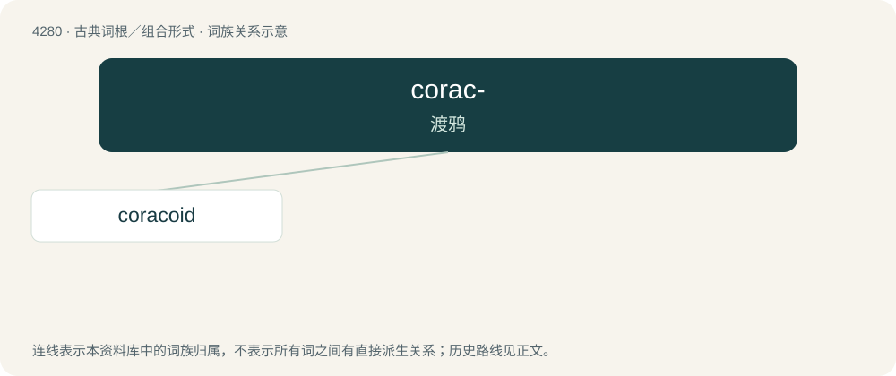

# 4283 · corac- — 渡鸦

[总目录](../00_总目录_按常用程度.md)

**类型**：古典词根／组合形式　｜　**来源语言**：古希腊语

## 核心含义与来源

- 核心含义：渡鸦
- 英文含义：raven
- 词形：corac-

**来源词形**：κόραξ, κόρακος (kórax, kórakos)

## 词族图

## 单词速览（常用到不常用）

| 单词 | 音标 | 释义 |
|---|---|---|
| [coracoid](#w-1) | /ˈkɒːrəkɒid/ | n. 鸟喙骨, 喙突；a. 喙状的 |

## 逐词详解

### 1. coracoid

**词性**：名词　｜　**音标**：/ˈkɒːrəkɒid/

**中文释义**：n. 鸟喙骨, 喙突；a. 喙状的

**英文义项**：Part of the scapula that projects towards the sternum in mammals; the coracoid process / A small bone linking the scapula and sternum in birds, reptiles and some other vertebrates

**词源与演化**：

From Latin corax + -oid.
