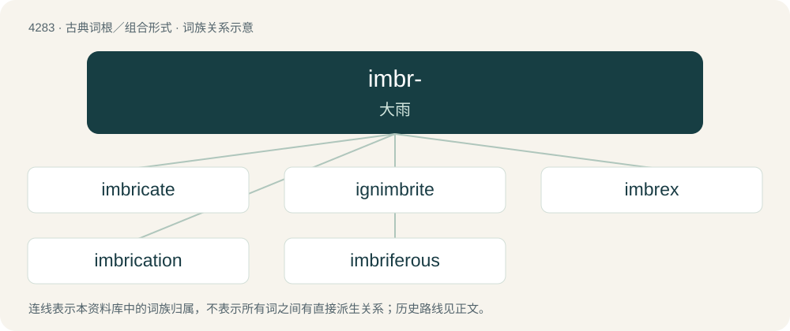

# 4284 · imbr- — 大雨

[总目录](../00_总目录_按常用程度.md)

**类型**：古典词根／组合形式　｜　**来源语言**：拉丁语

## 核心含义与来源

- 核心含义：大雨
- 英文含义：heavy rain
- 词形：imbr-

**来源词形**：imber, imbris

## 词族图

## 单词速览（常用到不常用）

| 单词 | 音标 | 释义 |
|---|---|---|
| [imbricate](#w-1) | /ˈimbrikeit/ | v. (使)边缘重叠成瓦状；a. 重叠成瓦状的, 鳞状的 |
| [ignimbrite](#w-2) | 英 /ˈɪɡnɪmbɹʌɪt/ | n. \[地\]熔结凝灰岩,熔灰岩 |
| [imbrex](#w-3) | /ˈimbreks/ | 槽瓦, 筒瓦 |
| [imbrication](#w-4) |  | \[医\] 迭盖 |
| [imbriferous](#w-5) |  | 【英文】Rainy; rain-causing; relating to rain. |

## 逐词详解

### 1. imbricate

**词性**：动词　｜　**音标**：/ˈimbrikeit/

**中文释义**：v. (使)边缘重叠成瓦状；a. 重叠成瓦状的, 鳞状的

**英文义项**：To overlap in a regular pattern. / To undergo or cause to undergo imbrication.

**词源与演化**：

Borrowed from Latin imbricātus (“tiled”).

**例句**：

> The roof tiles imbricate.

该用例对应义项：overlap

### 2. ignimbrite

**词性**：名词　｜　**音标**：英 /ˈɪɡnɪmbɹʌɪt/

**中文释义**：n. \[地\]熔结凝灰岩,熔灰岩

**英文义项**：A deposit left by a pyroclastic flow from a volcano, consisting of ash, pumice lapilli, and lithic fragments.

**词源与演化**：

By surface analysis, igni- (“fire”) + Latin imbris (“shower; stormcloud”) + -ite.

### 3. imbrex

**词性**：名词　｜　**音标**：/ˈimbreks/

**中文释义**：槽瓦, 筒瓦

**英文义项**：A roof tile common in Ancient Greek and Roman architecture, used in an overlapping formation with the tegula.

**词源与演化**：

Learned borrowing from Latin imbrex.

### 4. imbrication

**词性**：名词

**中文释义**：\[医\] 迭盖

**英文义项**：A set of tiles or shingles that overlap like the scales of a fish. / Overlapping of layers of tissue in wound closure or in correctional or reconstructive surgery.

**词源与演化**：

From French imbrication, from Latin imbricātus, from imbricō, from imbrex. By surface analysis, imbricate + -ion.

### 5. imbriferous

**词性**：形容词

**英文义项**：Rainy; rain-causing; relating to rain.

**词源与演化**：

From Latin imbrifer (“rain-bearing”) + English -ous.
