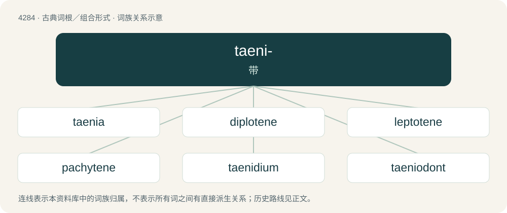

# 4286 · taeni- — 带

[总目录](../00_总目录_按常用程度.md)

**类型**：古典词根／组合形式　｜　**来源语言**：古希腊语

## 核心含义与来源

- 核心含义：带
- 英文含义：ribbon
- 词形：taeni-

**来源词形**：τείνειν (teínein), ταινία (tainía), ταινίδιον (tainídion)

## 词族图

## 单词速览（常用到不常用）

| 单词 | 音标 | 释义 |
|---|---|---|
| [taenia](#w-1) | /ˈtiːniə/ | n. 装饰头带, 带；\[医\] 带, 绦虫 |
| [diplotene](#w-2) | 英 /ˈdɪplətiːn/；美 /ˈdɪpləˌtin/ | n. & adj.\[生\]双线期(的) |
| [leptotene](#w-3) | /ˈleptəjtiːn/ | n. (细胞分裂中的)细线期 |
| [pachytene](#w-4) | /ˈpækitiːn/ | \[生\]n.粗线期(指细胞减数分裂前期的第三期, 其间配对的染色体变粗并分裂成染色单体) |
| [taenidium](#w-5) | /tiːˈniːdiəm/ | 螺旋丝 |
| [taeniodont](#w-6) |  | 【英文】Any of a group of extinct mammals of the suborder Taeniodonta |
| [zygotene](#w-7) | /ˈzai^ə,tiːn, ˈzi^ə-/ | n. \[生\](细胞减数分裂前期的)偶线期,合线期 |

## 逐词详解

### 1. taenia

**词性**：名词　｜　**音标**：/ˈtiːniə/

**中文释义**：n. 装饰头带, 带；\[医\] 带, 绦虫

**英文义项**：A ribbon worn in the hair in ancient Greece. / A band between the frieze and architrave in the Doric order.

**词源与演化**：

From Latin taenia, from Ancient Greek ταινία (tainía, “ribbon, tape”).

### 2. diplotene

**词性**：名词　｜　**音标**：英 /ˈdɪplətiːn/；美 /ˈdɪpləˌtin/

**中文释义**：n. & adj.\[生\]双线期(的)

**英文义项**：The fourth stage of prophase of meiosis, during which homologous chromosome pairs begin to separate and chiasmata become visible

**构词拆分**：diplo- + -tene

**词源与演化**：

From French diplotène, corresponding to diplo- + -tene. Coined by Hans von De Winiwarter in 1900 and in English by Edmund B. Wilson in 1912.

### 3. leptotene

**词性**：名词　｜　**音标**：/ˈleptəjtiːn/

**中文释义**：n. (细胞分裂中的)细线期

**英文义项**：The first part of the prophase of meiosis, characterized by threadlike chromosomes

**构词拆分**：lepto- (“thin”) + -tene (“ribbon”)

**词源与演化**：

From French leptotène, corresponding to lepto- (“thin”) + -tene (“ribbon”). Coined by Hans von De Winiwarter in 1900 and in English by Edmund B. Wilson in 1912.

### 4. pachytene

**词性**：名词　｜　**音标**：/ˈpækitiːn/

**中文释义**：\[生\]n.粗线期(指细胞减数分裂前期的第三期, 其间配对的染色体变粗并分裂成染色单体)

**英文义项**：The third stage of prophase 1 of meiosis, during which the chromosomes shorten and divide into four chromatids.

**构词拆分**：pachy- (“thick”) + -tene (“ribbon”)

**词源与演化**：

From French pachytène, equivalent to pachy- (“thick”) + -tene (“ribbon”). Coined by Hans von De Winiwarter in 1900 and in English by Edmund B. Wilson in 1912.

### 5. taenidium

**词性**：名词　｜　**音标**：/tiːˈniːdiəm/

**中文释义**：螺旋丝

**英文义项**：The chitinous fibre forming the spiral thread of the tracheae of insects

**词源与演化**：

From Latin taenia (“ribbon”) + -idium.

### 6. taeniodont

**词性**：名词

**英文义项**：Any of a group of extinct mammals of the suborder Taeniodonta

**词源与演化**：

From Ancient Greek ταινία (tainía, “band, ribbon”) + -odont.

### 7. zygotene

**词性**：名词　｜　**音标**：/ˈzai^ə,tiːn, ˈzi^ə-/

**中文释义**：n. \[生\](细胞减数分裂前期的)偶线期,合线期

**英文义项**：The intimate pairing of homologous chromosomes during the synaptic stage of meiosis

**构词拆分**：zygo- (“union, zygosis”, from Ancient Greek ζυγόν (zugón, “junction, yoke”)) + -tene (“filament”, from ταινία (tainía, “band, fillet”))；zygote + -tene

**词源与演化**：

From French zygotène, corresponding to zygo- (“union, zygosis”, from Ancient Greek ζυγόν (zugón, “junction, yoke”)) + -tene (“filament”, from ταινία (tainía, “band, fillet”)), equivalent to zygote + -tene. Coined by Victor Grégoire in 1907 and in English by Edmund B. Wilson in 1912.

## 其他候选词

- taenidia
- Taeniolabis
