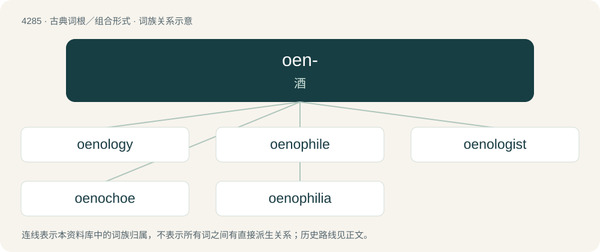

# 4287 · oen- — 酒

[总目录](../00_总目录_按常用程度.md)

**类型**：古典词根／组合形式　｜　**来源语言**：古希腊语

## 核心含义与来源

- 核心含义：酒
- 英文含义：wine
- 词形：oen-

**来源词形**：ϝοῖνος (woînos), οἶνος (oînos)

## 词族图

## 单词速览（常用到不常用）

| 单词 | 音标 | 释义 |
|---|---|---|
| [oenology](#w-1) | 英 /iˈnɒl.ə.d͡ʒi/；美 /iˈnɑ.lə.d͡ʒi/ | n. 酿酒学, 葡萄酒工艺学 |
| [oenophile](#w-2) | /ˈiː.nəʊˌfaɪl/ | n. 嗜酒的人,酒的行家,酒品尝家 |
| [oenologist](#w-3) | /ˈəʊnɒlədʒɪst/ | 酒类学家 |
| [oenochoe](#w-4) | 英 /iːˈnɒ.kəʊ.i/；美 /iːˈnɑ.kəʊ.i/ | n. (古希腊和古罗马的)陶酒坛(具有弧状把手和圆形或三叶状嘴) |
| [oenophilia](#w-5) |  | 【英文】A love or great appreciation of wine. |

## 逐词详解

### 1. oenology

**词性**：名词　｜　**音标**：英 /iˈnɒl.ə.d͡ʒi/；美 /iˈnɑ.lə.d͡ʒi/

**中文释义**：n. 酿酒学, 葡萄酒工艺学

**英文义项**：The scientific study of wines and winemaking.

**词源与演化**：

From oeno- + -logy.

### 2. oenophile

**词性**：名词　｜　**音标**：/ˈiː.nəʊˌfaɪl/

**中文释义**：n. 嗜酒的人,酒的行家,酒品尝家

**英文义项**：A person who has a fondness or appreciation for wine.

**构词拆分**：oeno- + -phile

**词源与演化**：

From oeno- + -phile.

**例句**：

> The oenophile had a large wine cellar stocked with bottles from around the world.

该用例对应义项：A person who has a fondness or appreciation for wine.

### 3. oenologist

**词性**：名词　｜　**音标**：/ˈəʊnɒlədʒɪst/

**中文释义**：酒类学家

**英文义项**：An expert in the science of oenology.

**构词拆分**：oenology + -ist；oeno- + -logist

**词源与演化**：

From oenology + -ist or oeno- + -logist.

### 4. oenochoe

**词性**：名词　｜　**音标**：英 /iːˈnɒ.kəʊ.i/；美 /iːˈnɑ.kəʊ.i/

**中文释义**：n. (古希腊和古罗马的)陶酒坛(具有弧状把手和圆形或三叶状嘴)

**英文义项**：A type of Ancient Greek pottery wine jug.

**词源与演化**：

From Ancient Greek οἰνοχόη (oinokhóē), from οἶνος (oînos, “wine”) + χέω (khéō, “to pour”).

### 5. oenophilia

**词性**：名词

**英文义项**：A love or great appreciation of wine.

**构词拆分**：oeno- + -philia

**词源与演化**：

From oeno- + -philia.

## 其他候选词

- enology
- oinochoe
