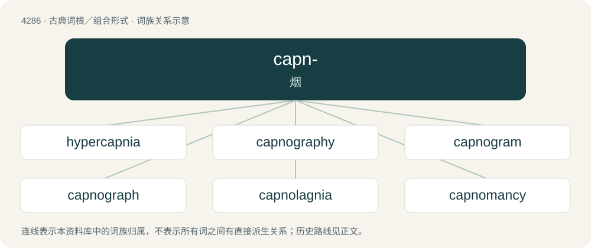

# 4288 · capn- — 烟

[总目录](../00_总目录_按常用程度.md)

**类型**：古典词根／组合形式　｜　**来源语言**：古希腊语

## 核心含义与来源

- 核心含义：烟
- 英文含义：smoke
- 词形：capn-

**来源词形**：καπνός (kapnós), καπνόομαι

## 词族图

## 单词速览（常用到不常用）

| 单词 | 音标 | 释义 |
|---|---|---|
| [hypercapnia](#w-1) | /,haipə(ː)ˈkæpniə/ | \[医\] \[血内\]碳酸过多, 高钙酸血 |
| [capnography](#w-2) | /kæpˈnəʊɡrəfɪ/ | \[医\]二氧化碳图 |
| [capnogram](#w-3) |  | 【英文】A diagnostic image produced by capnography. |
| [capnograph](#w-4) |  | 【英文】An instrument that measures the amount of carbon dioxide in a gas (especially expired breath) and displays it continuously |
| [capnolagnia](#w-5) |  | 【英文】A sexual fetish based on the sight and/or smell of someone smoking. |
| [capnomancy](#w-6) | /ˈkæpnəˌmænsi/ | n. 用烟占卜 |
| [capnometer](#w-7) |  | 二氧化碳检测计 |
| [capnometry](#w-8) |  | \[化\] 烟的密度测定 |
| [capnomor](#w-9) |  | 【英文】A colourless oil with a peculiar odour, obtained from beech tar. |
| [capnophile](#w-10) |  | 【英文】A microorganism that requires or grows best in presence of high concentrations of carbon dioxide. |
| [hypocapnia](#w-11) | /,haipəuˈkæpniə/ | (血内)碳酸过少, 低碳酸血(症) |

## 逐词详解

### 1. hypercapnia

**词性**：名词　｜　**音标**：/,haipə(ː)ˈkæpniə/

**中文释义**：\[医\] \[血内\]碳酸过多, 高钙酸血

**英文义项**：The condition of abnormally elevated carbon dioxide in the blood.

**构词拆分**：hyper- + capn- + -ia

**词源与演化**：

From hyper- + capn- + -ia; more at capno- § Etymology.

### 2. capnography

**词性**：名词　｜　**音标**：/kæpˈnəʊɡrəfɪ/

**中文释义**：\[医\]二氧化碳图

**英文义项**：The monitoring of the concentration or partial pressure of carbon dioxide in the respiratory gases, generally during anesthesia and intensive care.

**构词拆分**：capno- + -graphy

**词源与演化**：

From capno- + -graphy.

### 3. capnogram

**词性**：名词

**英文义项**：A diagnostic image produced by capnography.

**构词拆分**：capno- + -gram

**词源与演化**：

From capno- + -gram.

### 4. capnograph

**词性**：名词

**英文义项**：An instrument that measures the amount of carbon dioxide in a gas (especially expired breath) and displays it continuously

**构词拆分**：capno- + -graph

**词源与演化**：

From capno- + -graph.

### 5. capnolagnia

**词性**：名词

**英文义项**：A sexual fetish based on the sight and/or smell of someone smoking.

### 6. capnomancy

**词性**：名词　｜　**音标**：/ˈkæpnəˌmænsi/

**中文释义**：n. 用烟占卜

**英文义项**：Divination by interpreting smoke rising from a fire. A form of pyromancy.

**构词拆分**：capno- + -mancy

**词源与演化**：

Ancient Greek καπνός (kapnós, “smoke”); capno- + -mancy

### 7. capnometer

**词性**：名词

**中文释义**：二氧化碳检测计

**英文义项**：A medical instrument that measures carbon dioxide levels in the exhaled air of patients on ventilators or under anesthesia

**构词拆分**：capno- + -meter

**词源与演化**：

From capno- + -meter.

### 8. capnometry

**词性**：名词

**中文释义**：\[化\] 烟的密度测定

**英文义项**：measurement with a capnometer

**构词拆分**：capno- + -metry

**词源与演化**：

From capno- + -metry.

### 9. capnomor

**词性**：名词

**英文义项**：A colourless oil with a peculiar odour, obtained from beech tar.

**词源与演化**：

Borrowed from capno- + Ancient Greek μοῖρα (moîra, “part”), or some other derivative of μείρομαι (meíromai).

### 10. capnophile

**词性**：名词

**英文义项**：A microorganism that requires or grows best in presence of high concentrations of carbon dioxide.

**构词拆分**：capno- + -phile

**词源与演化**：

From capno- + -phile.

### 11. hypocapnia

**词性**：名词　｜　**音标**：/,haipəuˈkæpniə/

**中文释义**：(血内)碳酸过少, 低碳酸血(症)

**英文义项**：A state of diminished carbon dioxide in the blood.

**构词拆分**：hypo- + capn- + -ia

**词源与演化**：

From hypo- + capn- + -ia; more at capno- § Etymology.
